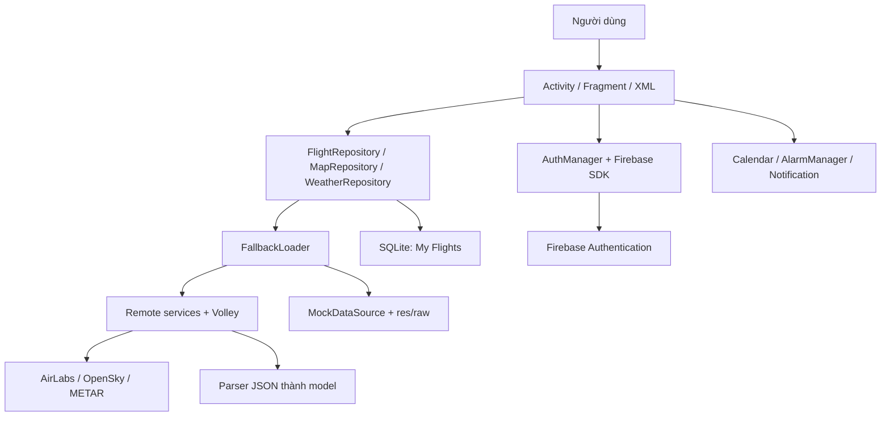
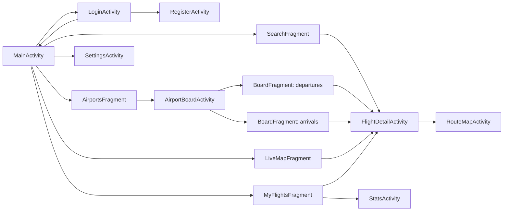
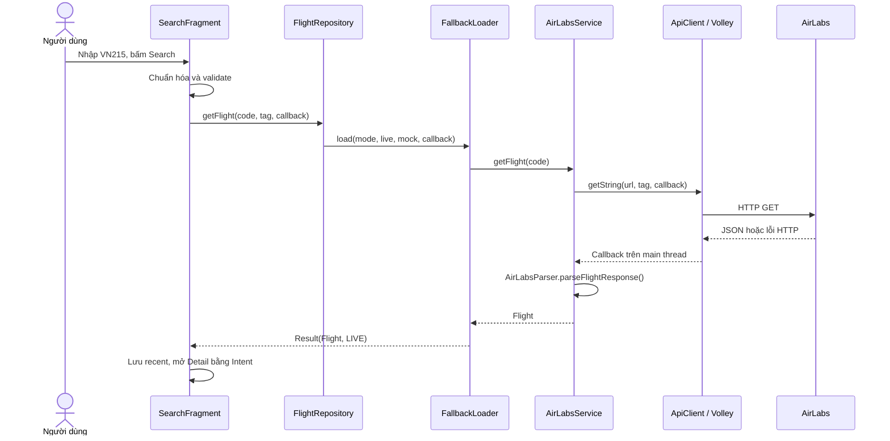
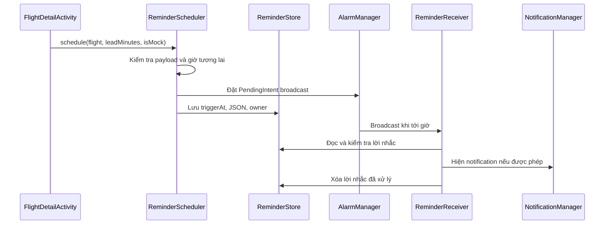

# Hiểu project Flight Info để thuyết trình final Mobile Application

Tài liệu này giải thích mã nguồn được đọc trong workspace ngày 28–29/10/2026. Mục tiêu là giúp bạn trả lời được: người dùng thao tác gì, lớp nào xử lý, dữ liệu đi đâu, vì sao dùng kỹ thuật đó và giới hạn hiện tại là gì.

Nguồn chính là code trong `app/src/main`, test trong `app/src/test`, cấu hình Gradle và các script trong `tools`. Các file SPEC và PLAN mô tả yêu cầu, không thay thế bằng chứng từ implementation. Đây là bản phân tích tĩnh mã nguồn, không phải báo cáo đã chạy thử API, Firebase hay toàn bộ ứng dụng trên thiết bị.

## Mục lục

1. [Bức tranh tổng thể](#1-bức-tranh-tổng-thể)
2. [Kiến thức Android và Java nền tảng](#2-kiến-thức-android-và-java-nền-tảng)
3. [Khởi động và điều hướng](#3-khởi-động-và-điều-hướng)
4. [Dữ liệu chuyến bay và quy tắc nghiệp vụ](#4-dữ-liệu-chuyến-bay-và-quy-tắc-nghiệp-vụ)
5. [Networking và API](#5-networking-và-api)
6. [Live, mock và fallback](#6-live-mock-và-fallback)
7. [SQLite, SharedPreferences và cache](#7-sqlite-sharedpreferences-và-cache)
8. [Đăng nhập và tài khoản](#8-đăng-nhập-và-tài-khoản)
9. [Luồng từng tính năng](#9-luồng-từng-tính-năng)
10. [Thiết kế giao diện và hiệu năng](#10-thiết-kế-giao-diện-và-hiệu-năng)
11. [Bản đồ từng file mã nguồn](#11-bản-đồ-từng-file-mã-nguồn)
12. [Layout và tài nguyên](#12-layout-và-tài-nguyên)
13. [Build, manifest và công cụ](#13-build-manifest-và-công-cụ)
14. [Test chứng minh điều gì](#14-test-chứng-minh-điều-gì)
15. [Giới hạn cần nói đúng](#15-giới-hạn-cần-nói-đúng)
16. [Kịch bản thuyết trình và demo](#16-kịch-bản-thuyết-trình-và-demo)
17. [Câu hỏi vấn đáp](#17-câu-hỏi-vấn-đáp)
18. [Lộ trình đọc code để tự hiểu](#18-lộ-trình-đọc-code-để-tự-hiểu)

## 1. Bức tranh tổng thể

### 1.1 App giải quyết vấn đề gì?

Flight Info giúp hành khách và người đi đón tra cứu chuyến bay, biết giờ đi/đến, trạng thái trễ, gate, terminal và thời tiết sân bay đến. App có bảng chuyến bay theo sân bay, bản đồ máy bay, lưu chuyến quan tâm, lịch, thống kê và nhắc giờ bay.

App không bán vé, không check-in và không phát hành boarding pass dùng để lên máy bay. Thẻ có hình thức boarding pass trong Detail là cách trình bày thông tin chuyến bay.

### 1.2 Công nghệ đang dùng

| Thành phần | Trong project |
|---|---|
| Nền tảng | Android native |
| Ngôn ngữ ứng dụng | Java 17 |
| Giao diện | XML Views, Activity, Fragment, Material Components |
| Networking | Volley, HTTP GET, JSON |
| Dữ liệu chuyến bay | AirLabs |
| Vị trí máy bay | OpenSky |
| Thời tiết | aviationweather.gov, bản tin METAR |
| Bản đồ | osmdroid, tile OpenStreetMap |
| Tài khoản | Firebase Authentication bằng email và mật khẩu |
| Lưu chuyến bay | SQLite thông qua SQLiteOpenHelper |
| Cài đặt và dữ liệu nhỏ | SharedPreferences |
| Công việc nền trong app | ExecutorService, Handler, callback |
| Nhắc giờ | AlarmManager, BroadcastReceiver, Notification |
| Kiểm thử | JUnit 4, Robolectric, thư viện org.json cho JVM |

### 1.3 Backend thực sự nằm ở đâu?

Repository này **không chứa backend server tự viết**. Không có Spring Boot, Node.js, REST controller hay database server riêng. Logic xử lý dữ liệu ở `data/` vẫn chạy trong tiến trình Android.

**Vì sao kiến trúc hiện tại không có server riêng?** Ba nhà cung cấp đã có API cho dữ liệu mà app cần: AirLabs cho chuyến bay, OpenSky cho vị trí máy bay và Aviation Weather cho METAR. Firebase Authentication đã cung cấp dịch vụ tài khoản. Những dữ liệu do app quản lý như chuyến đã lưu, lịch sử tìm kiếm và cài đặt chỉ cần dùng trên thiết bị trong phạm vi project hiện tại. Vì vậy, Android client gọi các dịch vụ đó trực tiếp và lưu dữ liệu riêng bằng SQLite hoặc SharedPreferences. Đây là cách tổ chức thể hiện trong code; không có tài liệu quyết định thiết kế nào chứng minh một lý do duy nhất của nhóm. Nếu sau này cần đồng bộ nhiều thiết bị, quản lý API key ở phía server hoặc gửi thông báo khi trạng thái chuyến bay thay đổi, kiến trúc sẽ cần thêm thành phần server và database phù hợp.

**"Xử lý dữ liệu trong app" là xử lý những gì?** Các lớp Java trong APK thực hiện những bước sau ngay trên điện thoại:

1. `SearchFragment` chuẩn hóa và kiểm tra mã nhập như `VN215` trước khi gửi request.
2. `FlightRepository` đọc chế độ Auto/Live/Mock và `FallbackLoader` quyết định lấy API thật hay dữ liệu mẫu khi có lỗi.
3. `AirLabsService`, `OpenSkyService` và `MetarService` tạo URL; Volley gửi HTTP GET và nhận JSON. Máy chủ của nhà cung cấp mới là nơi trả dữ liệu gốc.
4. Các parser đọc JSON, bỏ field không hợp lệ hoặc thiếu, rồi tạo `Flight`, `AircraftState` và `Weather`. `Flight` tính giờ ưu tiên và độ trễ; `FlightStatus` chuẩn hóa trạng thái.
5. `SavedFlightsDb` ghi và đọc snapshot chuyến đã lưu theo owner. `RecentSearches`, `Prefs` và `ReminderStore` giữ dữ liệu nhỏ trong SharedPreferences.
6. `FlightStats` tính tổng chuyến, khoảng cách và các chỉ số từ danh sách đã lưu; `GeoUtils` nội suy tuyến giữa hai sân bay. Đây là phép tính cục bộ, không phải kết quả một endpoint backend của nhóm.
7. Activity/Fragment nhận kết quả bằng callback và cập nhật View trên main thread. `ReminderScheduler` nhờ Android AlarmManager phát lời nhắc từ dữ liệu đã lưu.

Ví dụ khi tìm `VN215`, server AirLabs trả JSON chuyến bay. App tự parse JSON, tính trạng thái hiển thị, chọn bản mock nếu lỗi phù hợp, rồi render Detail. Phần "backend" trong sơ đồ của project là **tầng data phía client**; nó không phải một chương trình đang chạy trên máy chủ của nhóm. Firebase quản lý danh tính người dùng, nhưng không chứa My Flights của project.

Kiến trúc chính là:



Nếu thầy hỏi "backend hoạt động như thế nào?", bạn có thể nói:

> Ứng dụng của em dùng dịch vụ dữ liệu bên ngoài làm phía server. Trong Android, em tách repository để chọn nguồn dữ liệu, service để gọi HTTP và parser để chuyển JSON thành model. Firebase quản lý xác thực. Chuyến bay đã lưu nằm trong SQLite trên thiết bị, chưa đồng bộ lên cloud.

### 1.4 Có phải MVVM không?

Toàn app là kiến trúc phân lớp `ui → data → remote/local/mock`, có model và repository. Activity và Fragment vẫn trực tiếp điều phối nhiều logic giao diện và callback. Riêng phần đăng nhập có `AuthViewModel` và `LiveData`.

Vì vậy, mô tả chính xác là "kiến trúc phân lớp dùng Repository, phần auth áp dụng ViewModel/LiveData". Không nên khẳng định mọi màn hình đều triển khai MVVM đầy đủ.

## 2. Kiến thức Android và Java nền tảng

### 2.1 Activity, Fragment và View

Activity là một màn hình do Android quản lý vòng đời. `MainActivity` chứa thanh công cụ và bốn tab. `FlightDetailActivity` là màn hình riêng để xem một chuyến bay.

Fragment là phần giao diện có vòng đời nằm trong Activity. Các tab Search, Airports, Map và My Flights dùng Fragment để chung một khung điều hướng.

View là thành phần hiển thị hoặc nhận tương tác như TextView, Button, RecyclerView. XML mô tả cây View. Java gọi `setContentView`, `inflate`, `findViewById`, gắn listener và đưa dữ liệu vào View. Project không dùng Jetpack Compose hay Data Binding.

### 2.2 Lifecycle liên quan trực tiếp đến tính năng

| Callback | Ý nghĩa và ví dụ trong app |
|---|---|
| `Application.onCreate()` | Khởi tạo hạ tầng dùng chung của tiến trình |
| `Activity.onCreate()` | Inflate layout, khôi phục state, gắn listener |
| `onResume()` | Màn hình hoạt động, có thể bắt đầu vòng refresh |
| `onPause()` | Dừng timer định kỳ để tránh làm việc khi rời màn hình |
| `onStop()` | Một số màn hủy request Volley theo tag |
| `Fragment.onCreateView()` / `onViewCreated()` | Tạo View và thiết lập giao diện Fragment |
| `Fragment.onDestroyView()` | Giải phóng phần gắn với View, đặc biệt MapView |
| `onSaveInstanceState()` | Giữ snapshot/state cần khôi phục khi Activity bị tạo lại |

Điểm cần hiểu: `hide(fragment)` không tự đồng nghĩa với `onPause()` của Fragment. Vì MainActivity giữ các tab bằng show/hide, tab bản đồ xét trạng thái bị ẩn để dừng refresh và hủy request. MapView nhận onResume/onPause theo lifecycle của Fragment; hook ẩn tab không tự gọi MapView.onPause().

### 2.3 Main thread, worker thread và callback

Main thread xử lý tương tác và vẽ giao diện. Nếu bắt nó chờ mạng hoặc đọc database lâu, app có thể giật hoặc ANR. Worker thread xử lý tác vụ nền, rồi đưa kết quả về main thread để cập nhật View.

`AppExecutors` có pool hai worker và `Handler(Looper.getMainLooper())`:

```java
AppExecutors executors = AppExecutors.get();
executors.io(() -> {
	List<Flight> flights = savedDb.getAll(owner);
	executors.main(() -> callback.onSuccess(flights));
});
```

`Callback<T>` là hợp đồng báo kết quả sau này bằng `onSuccess(T)` hoặc `onError(ApiException)`. Hàm `getFlight()` không trả ngay `Flight`, vì request chưa xong khi hàm kết thúc.

Volley tự thực hiện I/O mạng bất đồng bộ và giao kết quả về main thread. Một chi tiết của code hiện tại: các service gọi parser trong callback nhận chuỗi của Volley, nên phần parser JSON đó chạy trên main thread. Không nên nói toàn bộ parsing đã chuyển sang background. Mock và SQLite sử dụng executor riêng.

Hủy request theo tag chỉ tác động request trong Volley. Nó không hủy Firebase Task, công việc executor hay mọi callback đã được xếp hàng.

### 2.4 Các khái niệm Java cần giải thích được

| Khái niệm | Ví dụ cụ thể |
|---|---|
| Encapsulation | `Flight` giữ field private, truy cập bằng getter/setter |
| Inheritance | `SavedFlightsDb extends SQLiteOpenHelper`, Activity kế thừa AppCompatActivity |
| Interface | `Callback<T>`, `TabFragment.Host` quy định cách trao đổi |
| Polymorphism | MainActivity gọi `onRefreshRequested()` qua kiểu TabFragment, subclass quyết định xử lý |
| Generic | `Result<Flight>`, `Callback<List<Flight>>` giữ đúng kiểu dữ liệu |
| Enum | `FlightStatus`, `DataMode`, `DataSource` giới hạn tập giá trị |
| Lambda | `v -> search()` hoặc `() -> savedDb.update(...)` truyền hành vi |
| Singleton | ApiClient, repository, AirportStore có instance dùng chung |
| Immutable object | Airport, Weather, AircraftState giữ dữ liệu không thay đổi sau khởi tạo |
| Nullable wrapper | `Integer`/`Double` có thể là null để biểu diễn thiếu dữ liệu |

Ví dụ gió `0` độ nghĩa là gió từ hướng Bắc. Gió `null` là không có hướng số để hiển thị, có thể vì API trả `VRB`. Không được dùng số 0 để thay mọi dữ liệu thiếu.

## 3. Khởi động và điều hướng

### 3.1 Từ biểu tượng app đến màn hình chính

Manifest khai báo `MainActivity` có `MAIN` và `LAUNCHER`, nên đây là entry point khi bấm icon. Android tạo `FlightInfoApp` trước, rồi tạo Activity.

`FlightInfoApp` khởi tạo ApiClient, chuẩn bị auth/preferences/recent ở worker và bật StrictMode trong debug. Notification channel được tạo khi ReminderReceiver chuẩn bị thông báo. `MainActivity` kiểm tra session; nếu chưa đăng nhập và chưa chọn guest, chuyển sang Login. Khi có session, người dùng vào bốn tab.

Đừng nhầm launcher với màn đầu người dùng nhìn thấy. MainActivity là launcher nhưng có thể chuyển ngay sang LoginActivity.

### 3.2 Cấu trúc các màn hình



MainActivity tạo tab khi cần rồi `add/show/hide`, thay vì `replace` mỗi lần. Cách này giữ View và trạng thái tab, đổi lại phải quản lý lifecycle khi tab bị ẩn.

### 3.3 Intent và dữ liệu giữa màn hình

Explicit Intent chỉ rõ Activity nhận, ví dụ mở Detail. Detail nhận mã chuyến và có thể nhận JSON chuyến bay để hiển thị ngay, sau đó mới cập nhật dữ liệu.

Implicit Intent mô tả việc muốn làm để Android chọn app xử lý. Share dùng `ACTION_SEND`; thêm lịch dùng `ACTION_INSERT` cùng URI Calendar.

JSON truyền giữa màn hình là một snapshot. Nó không tự cập nhật và không phải liên kết trực tiếp đến một đối tượng còn sống ở màn hình trước. Truyền snapshot lớn qua Intent cũng có giới hạn kích thước Binder, dù một bản ghi chuyến bay thường nhỏ.

### 3.4 State sau xoay màn hình

Xoay máy thường làm Activity và View tạo lại. Bundle giữ các giá trị nhỏ như JSON hiện tại, tab đang chọn hoặc trạng thái mở rộng METAR ở các màn có triển khai. FragmentManager cũng khôi phục Fragment đã có.

Auth dùng ViewModel giữ form và request qua configuration change. ViewModel không tự sống sót khi tiến trình bị hệ điều hành hủy. Mật khẩu chỉ ở bộ nhớ, không ghi vào Bundle hoặc preferences của ứng dụng.

## 4. Dữ liệu chuyến bay và quy tắc nghiệp vụ

### 4.1 Phân biệt các loại mã

| Mã | Ví dụ | Ý nghĩa trong app |
|---|---|---|
| IATA sân bay | HAN, SGN | Tìm sân bay, board, hiển thị tuyến |
| ICAO sân bay | VVNB, VVTS | Gọi METAR |
| IATA chuyến | VN215 | Search và định danh lưu chuyến |
| ICAO callsign | HVN215 | OpenSky trả về, app thử đổi sang VN215 |
| IATA hãng | VN | Tên hãng và URL logo |
| ICAO24 | Mã hex máy bay | Định danh aircraft state, khác số hiệu chuyến |

Callsign không đảm bảo luôn chuyển thành số hiệu thương mại. `Airlines` chỉ có bảng hãng biết trước và quy tắc chuyển đổi, không phải dữ liệu đối chiếu mọi chuyến bay trên thế giới.

### 4.2 Model Flight chứa gì?

`Flight` chứa mã chuyến/hãng, sân bay đi/đến, terminal, gate, baggage, giờ scheduled/estimated/actual, độ trễ, loại máy bay, registration, duration và raw JSON.

Ba loại thời gian có ý nghĩa khác nhau:

- Scheduled là lịch công bố ban đầu.
- Estimated là dự kiến được cập nhật.
- Actual là thời điểm thực tế đã ghi nhận.

`getBestDepTs()` và `getBestArrTs()` ưu tiên `actual → estimated → scheduled`. Các getter lấy text giờ cũng dùng thứ tự đó.

API dùng UNIX timestamp theo **giây**. `System.currentTimeMillis()`, Calendar và AlarmManager dùng **mili giây**. Vì vậy, ở ranh giới Android thường cần nhân `1000L`.

Chuỗi `yyyy-MM-dd HH:mm` là giờ địa phương của sân bay. Không lấy giờ dạng text của hai sân bay khác múi giờ để trừ trực tiếp. Timestamp dùng để so sánh thời điểm.

### 4.3 Trạng thái chuyến bay

| Raw status | Điều kiện | FlightStatus |
|---|---|---|
| `scheduled` | Delay dưới 15 phút hoặc chưa có delay | SCHEDULED |
| `scheduled` | Delay từ 15 phút | DELAYED |
| `active`, `en-route` | Bất kể delay | EN_ROUTE |
| `landed` | | LANDED |
| `cancelled` | | CANCELLED |
| Không biết hoặc thiếu | | UNKNOWN |

Độ trễ lấy `dep_delayed` nếu có, nếu thiếu thì tính `(depEstimatedTs - depTimeTs) / 60`. Code không suy độ trễ bằng actual timestamp trong nhánh này.

Máy bay đã cất cánh nhưng xuất phát muộn vẫn có trạng thái EN_ROUTE. `isDelayed()` có thể đồng thời đúng. Trạng thái hành trình và số phút trễ là hai thông tin khác nhau.

### 4.4 Phần trăm hành trình

`TimeUtils.progressPercent()` tính:

```text
progress = (now - departure) × 100 / (arrival - departure)
```

Hàm giới hạn kết quả trong 0–100. Nếu giờ không hợp lệ, trả -1. UI còn áp dụng trạng thái: LANDED = 100%, SCHEDULED/DELAYED/CANCELLED = 0%.

Ví dụ dự kiến bay 10:00–12:00 và hiện là 11:00 thì progress xấp xỉ 50%. Đây là tỷ lệ thời gian, không đo trực tiếp máy bay đã đi được bao nhiêu km.

## 5. Networking và API

### 5.1 Request đang được tạo trong code

Các URL dưới đây mô tả implementation, không xác nhận dịch vụ đang hoạt động hoặc chính sách truy cập hiện tại của nhà cung cấp. `<KEY>` là ký hiệu minh họa.

| Tính năng | Method và URL | Input quan trọng |
|---|---|---|
| Tra cứu một chuyến | `GET https://airlabs.co/api/v9/flight?flight_iata=VN215&api_key=<KEY>` | IATA chuyến |
| Chuyến đi tại HAN | `GET https://airlabs.co/api/v9/schedules?dep_iata=HAN&api_key=<KEY>` | `dep_iata` |
| Chuyến đến HAN | `GET https://airlabs.co/api/v9/schedules?arr_iata=HAN&api_key=<KEY>` | `arr_iata` |
| Máy bay trong vùng | `GET https://opensky-network.org/api/states/all?lamin=8.0&lomin=102.0&lamax=24.0&lomax=110.0` | Bounding box |
| Thời tiết Nội Bài | `GET https://aviationweather.gov/api/data/metar?ids=VVNB&format=json` | ICAO sân bay |
| Logo Vietnam Airlines | `GET https://pics.avs.io/200/200/VN.png` | IATA hãng |

AirLabs và METAR dùng `Uri.Builder.appendQueryParameter()` để ghép và encode tham số. OpenSky dùng URL format với `Locale.US`, tránh số thập phân bị định dạng dấu phẩy theo locale.

Không có HTTP POST tạo chuyến bay hay DELETE chuyến bay khi bỏ lưu. Save/unsave chỉ thay đổi SQLite. Firebase sử dụng SDK, app không tự xây endpoint auth REST.

### 5.2 Luồng request Search VN215



Vì request bất đồng bộ, UI cần trạng thái đang tải. Callback phải kiểm tra màn hình/View còn phù hợp trước khi cập nhật. Không có bảo đảm response luôn về theo đúng thứ tự người dùng bắt đầu request.

### 5.3 ApiClient và Volley

ApiClient giữ một RequestQueue dùng application context. Một queue chung tránh tạo lại hạ tầng mạng cho từng Activity và tránh giữ Activity đã bị hủy.

`getString()` tạo `Utf8StringRequest`, gắn tag, gắn retry policy rồi đưa vào queue. Timeout ban đầu là 10 giây, tối đa một retry với backoff mặc định. Tổng thời gian chờ có thể dài hơn 10 giây.

`Utf8StringRequest` luôn giải mã response thành UTF-8 và giữ metadata cache của HTTP. Điều này khắc phục trường hợp server thiếu charset khiến request mặc định giải mã sai chữ có dấu; implementation này cũng không dùng charset khác dù header khai báo.

ImageLoader dùng LruCache, giới hạn khoảng 1/8 heap, tính kích thước theo byte bitmap. Cache này dành cho ảnh đã decode, khác cache HTTP trên đĩa.

### 5.4 Parse JSON thành model

JSON là dữ liệu văn bản có cấu trúc. Parser chuyển field của nhà cung cấp sang kiểu Java để UI không phải biết toàn bộ định dạng bên ngoài.

Ví dụ rút gọn, chỉ minh họa các field parser nhận:

```json
{
	"response": {
		"flight_iata": "VN215",
		"airline_iata": "VN",
		"dep_iata": "HAN",
		"arr_iata": "SGN",
		"status": "active",
		"dep_time_ts": 1700000000,
		"arr_time_ts": 1700007200
	}
}
```

AirLabsParser nhận wrapper `response`, object trực tiếp hoặc array. Với một chuyến, parser có thể lấy phần tử đầu của array. Nó cũng kiểm tra object `error`, vì HTTP thành công chưa chắc nghiệp vụ thành công.

OpenSky khác AirLabs: mỗi aircraft state là một array có ý nghĩa theo vị trí.

| Index | Nội dung |
|---|---|
| 0, 1, 2 | icao24, callsign, origin_country |
| 5, 6 | Longitude, latitude |
| 7, 8 | Barometric altitude, on_ground |
| 9, 10, 11 | Velocity, true_track, vertical_rate |

Parser bỏ máy bay thiếu lat/lon vì không thể vẽ lên map. `states: null` trả danh sách rỗng thành công.

METAR là bản tin quan trắc thời tiết hàng không. App đọc nhiệt độ °C, gió knot, hướng độ, tầm nhìn dạng chuỗi, flight category và raw METAR. `wdir = "VRB"` nghĩa hướng gió thay đổi, được biểu diễn bằng null ở field hướng số. App hiển thị category do API trả về, không tự tính quy tắc phân loại VFR/IFR.

### 5.5 Phân loại lỗi

| Loại ApiException | Ví dụ |
|---|---|
| NETWORK | Timeout, lỗi mạng |
| NO_KEY | Key rỗng, authentication failure, HTTP 401/403 |
| QUOTA | HTTP 429, mã lỗi quota trong JSON AirLabs |
| NOT_FOUND | HTTP 404, không có chuyến hoặc METAR |
| PARSE | JSON sai định dạng |
| SERVER | Lỗi còn lại |

`ErrorMessages` biến loại lỗi thành string resource phù hợp ngôn ngữ. Auth có mapper riêng để phân biệt email sai, mật khẩu yếu, tài khoản trùng và các lỗi Firebase.

## 6. Live, mock và fallback

### 6.1 DataMode khác DataSource

DataMode là người dùng **muốn lấy từ đâu** trước request. DataSource là kết quả **thực sự lấy từ đâu** sau request. Ví dụ DataMode AUTO có thể tạo Result với DataSource MOCK.

| Mode | Khi live thành công | Khi live lỗi |
|---|---|---|
| LIVE | Trả live | Báo lỗi |
| MOCK | Không gọi live | Chỉ tìm trong bộ mock |
| AUTO | Trả live | Fallback mock trừ NOT_FOUND |

NOT_FOUND không fallback vì "chuyến không tồn tại" là một câu trả lời nghiệp vụ. Nếu thay bằng chuyến mẫu, người dùng có thể tưởng đang thấy dữ liệu thật của chuyến vừa tra.

`Result<T>` gói `data` và `source`; `isMock()` giúp hiện banner demo. Cơ chế dùng generic Source nên FlightRepository, MapRepository và WeatherRepository dùng chung được.

### 6.2 Mock là dữ liệu được thiết kế, không phải cache live

`res/raw/mock_flights.json`, `mock_opensky.json`, `mock_metar.json` nằm trong APK. MockDataSource đọc file ở worker và giữ raw text trong bộ nhớ, rồi parse theo request.

MockTimeShifter lấy chênh lệch giữa hiện tại và `anchor_ts`, làm tròn theo bước 300 giây. Nó dịch đồng thời các chuỗi giờ và timestamp để demo trông như dữ liệu hiện tại. Object JSON gốc được copy trước khi dịch.

MockQueries tìm theo flight number, chọn chuyến có scheduled departure gần hiện tại nhất nếu trùng mã, lọc schedules theo sân bay và sắp xếp theo giờ scheduled.

Máy bay mock di chuyển theo hướng và tốc độ: quãng đường = velocity × elapsed. Thời gian elapsed lặp lại sau 1800 giây tính từ lúc singleton được tạo. Đây là chuyển động giả phục vụ demo. METAR mock vẫn là bản tin mẫu.

### 6.3 Mock không có nghĩa mọi tài nguyên đều offline

Chọn MOCK ngăn repository gọi API chuyến bay, vị trí máy bay và METAR thật. Logo, tile bản đồ và Firebase vẫn có các đường truy cập mạng riêng.

Vì vậy khi tắt mạng, thông tin mock vẫn có thể hiện đầy đủ nhưng nền bản đồ chưa cache hoặc logo chưa tải có thể thiếu. Nên mở trước các bản đồ và chuẩn bị mạng cho demo auth.

## 7. SQLite, SharedPreferences và cache

### 7.1 Vì sao dùng các cách lưu khác nhau?

| Cách lưu | Dữ liệu | Lý do |
|---|---|---|
| SQLite | Danh sách chuyến đã lưu theo owner | Có bảng, truy vấn, cập nhật, khóa ghép và migration |
| SharedPreferences | Settings, recent, guest, reminders | Dữ liệu nhỏ theo key-value |
| assets/raw | Sân bay tĩnh và dữ liệu mẫu | Đóng gói sẵn, đọc được không cần flight API |
| Cache RAM | Sân bay đã parse, raw mock, bitmap logo | Giảm đọc và xử lý lặp |
| HTTP/tile cache | Response Volley, tile osmdroid | Tận dụng dữ liệu từng tải theo cơ chế thư viện |

SQLite không tự đồng bộ với Firebase. Xóa dữ liệu app sẽ làm mất dữ liệu lưu cục bộ. Đăng nhập lại trên thiết bị khác không tự mang My Flights sang.

### 7.2 Schema SQLite thực tế

Database `flight_info.db`, version 2:

```sql
CREATE TABLE saved_flights (
	owner TEXT NOT NULL,
	flight_iata TEXT,
	json TEXT NOT NULL,
	saved_at INTEGER NOT NULL,
	PRIMARY KEY (owner, flight_iata)
);
```

Owner là Firebase UID hoặc `guest`. Cùng VN215 có thể thuộc user A, user B và guest ở các row riêng.

Flight JSON giữ snapshot đầy đủ và tái sử dụng AirLabsParser khi đọc. Cách này giảm mapping nhiều cột, nhưng khó truy vấn SQL trực tiếp theo gate/status và phụ thuộc khả năng parser đọc format đã lưu.

### 7.3 Save, refresh và delete khác nhau

- `save()` dùng `CONFLICT_REPLACE`, ghi saved_at mới và đưa chuyến lên đầu danh sách.
- `update()` chỉ sửa JSON của row đã có. Nó không tạo chuyến mới và không đổi thứ tự lưu.
- `getAll(owner)` lọc owner và sắp xếp saved_at giảm dần.
- `delete()` và `isSaved()` dùng cả owner lẫn flight_iata.

`selectionArgs` truyền owner/mã chuyến vào dấu `?`, tránh ghép dữ liệu người dùng vào biểu thức SQL. Cursor được đóng bằng try-with-resources.

Repository chụp owner trước khi xếp việc vào executor. Nếu người dùng đổi account trong lúc worker đang chờ, thao tác đó vẫn dùng owner đã chụp.

Khóa chưa có ngày bay. Một owner không lưu được hai lần VN215 ở hai ngày như hai chuyến độc lập. Đây là giới hạn mô hình dữ liệu cần biết.

### 7.4 Migration từ version 1 sang 2

Code tạo bảng mới có owner, copy row cũ với owner `guest`, xóa bảng cũ rồi đổi tên bảng mới. SQLiteOpenHelper quản lý transaction của upgrade. Mục tiêu là giữ chuyến đã lưu ở bản cũ khi bổ sung tài khoản.

Trường flight_iata vẫn cho phép null để giữ row legacy thiếu IATA. Test migration có kiểm tra trường hợp này.

### 7.5 Dữ liệu nào phân tài khoản?

My Flights phân theo owner trong SQLite. RecentSearches và settings dùng chung trên thiết bị. Recent lưu tối đa 10 snapshot JSON và loại trùng theo mã chuyến.

Reminder có owner để kiểm tra khi đọc/phát thông báo, nhưng storage key vẫn chỉ là flight_iata. Do đó hai account đặt nhắc cùng VN215 có thể thay thế cùng một bản ghi. Không nên mô tả reminder tách biệt hoàn toàn như khóa ghép SQLite.

## 8. Đăng nhập và tài khoản

### 8.1 Phân công trách nhiệm

Firebase Authentication quản lý tài khoản, kiểm tra credential và duy trì session qua SDK. AuthManager là lớp bọc để UI sử dụng. AuthViewModel giữ form, trạng thái busy và kết quả thao tác; Activity quan sát LiveData để vẽ UI và điều hướng.

Project không tự lưu mật khẩu vào database hay SharedPreferences. Guest là cờ cục bộ, không phải Firebase anonymous authentication.

### 8.2 Luồng sign in và reset password

Login kiểm tra email và mật khẩu trước khi gọi mạng. AuthViewModel đặt busy rồi gọi AuthManager. Manager dùng `signInWithEmailAndPassword()`. Thành công thì kiểm tra profile còn pending, hoàn tất nếu cần, bỏ guest flag và báo UI chuyển về Main.

Reset chỉ cần email hợp lệ, gọi `sendPasswordResetEmail()`. Nó không cần mật khẩu hiện tại.

Busy giúp tránh submit trùng. Firebase Task không bị hủy đơn giản bằng việc xoay màn hình. ViewModel giữ trạng thái nên Activity mới quan sát kết quả thay vì tạo lại request chỉ vì rotation.

### 8.3 Đăng ký gồm hai bước, có thể thành công một phần

1. Validate tên, email, mật khẩu và xác nhận mật khẩu.
2. Gọi `createUserWithEmailAndPassword()`.
3. Lưu tên dưới key `pending_profile_<uid>`.
4. Gọi `updateProfile(displayName)`.
5. Thành công thì xóa pending và cho vào Main.
6. Nếu updateProfile lỗi, account đã tồn tại. App giữ pending, sign out và thông báo để người dùng sign in lại.
7. Lần sign in sau thử hoàn tất profile thay vì tạo account lần nữa.

Đây là ví dụ thực tế về chuỗi hai thao tác mạng không có một transaction chung. Không được xem bước 4 thất bại là bước 2 chưa xảy ra.

### 8.4 Không có cấu hình Firebase thì sao?

Gradle chỉ áp dụng plugin google-services khi file cấu hình tồn tại. AuthManager chấp nhận FirebaseAuth null và báo NOT_CONFIGURED. Người dùng vẫn có thể vào guest.

File `google-services.json` là cấu hình kết nối Firebase Android, không phải tài khoản service admin. Trong tài liệu này không chép giá trị key hay project identifier thực tế.

## 9. Luồng từng tính năng

### 9.1 F1: Tìm kiếm chuyến bay

`SearchFragment.search()` xóa whitespace, chuyển input thành chữ hoa và kiểm tra regex `^[A-Z0-9]{2}\d{1,4}$`. Nghĩa là hai ký tự chữ hoặc số của hãng, tiếp theo là một đến bốn chữ số.

Input sai thì TextInputLayout báo lỗi ngay, không gửi request. Input đúng thì ẩn bàn phím, bật progress, khóa nút tìm và gọi FlightRepository.

Thành công thì lưu recent và mở Detail với JSON đã nhận, không bắt Detail tải lại ngay. Bấm một recent item mở snapshot cũ và yêu cầu refresh. Lỗi hiện Snackbar có Retry. `onStop()` hủy request Volley theo tag Fragment.

Lịch sử recent là dữ liệu local, không phải danh sách tất cả chuyến trên server. Regex chỉ xác nhận hình thức input, không chứng minh chuyến tồn tại.

### 9.2 F2: Chi tiết chuyến bay

Detail ưu tiên JSON được khôi phục trong Bundle, sau đó JSON trong Intent. Nếu chưa có dữ liệu hoặc Intent yêu cầu refresh thì gọi repository. AirportStore load xong sẽ render lại để bổ sung tên thành phố và tọa độ.

`render()` gắn logo, mã/hãng, status, hai sân bay, giờ tốt nhất và progress. Khi giờ mới khác giờ scheduled, code cho hiện giờ cũ bị gạch ngang. `bindInfoRows()` inflate từng `item_info_row.xml` cho gate/terminal, baggage, máy bay, registration, duration và độ trễ.

Thời tiết lấy theo ICAO sân bay đến. Nếu flight thiếu ICAO thì thử tra AirportStore bằng IATA. Bấm raw METAR đổi chiều cao View giữa một dòng và WRAP_CONTENT.

Trong `onResume()`, nếu setting auto-refresh bật, Handler đặt công việc sau 60 giây. Công việc chỉ tải lại chuyến chưa LANDED/CANCELLED. `onPause()` bỏ callback timer, `onStop()` hủy flight/weather request, `onDestroy()` detach MapView.

Weather có guard `loadedWeatherIcao` để tránh gọi lại cùng sân bay liên tục. Do đó refresh flight không đồng nghĩa weather cũng tải lại mỗi phút. Banner Detail phản ánh nguồn của flight; weather có thể fallback riêng.

Save dùng SQLite bất đồng bộ. Ngôi sao bị disable khi chưa biết chuyến đã lưu hay chưa. Share tạo ACTION_SEND với text/plain và mở chooser.

### 9.3 F3: Danh sách sân bay và bảng giờ

AirportsFragment gọi AirportStore đọc `assets/airports.json`, hiển thị bằng RecyclerView. Filter so khớp IATA, ICAO, tên, thành phố và tên thành phố tiếng Việt, không phân biệt hoa thường. Code không bỏ dấu để tìm kiếm tiếng Việt không dấu.

Sân bay mặc định được đưa lên đầu danh sách sau lọc. Mặc định ban đầu là HAN.

Chọn sân bay mở AirportBoardActivity. `BoardPagerAdapter` tạo hai BoardFragment với arguments gồm mã sân bay và boolean departures. TabLayoutMediator nối TabLayout với ViewPager2.

BoardFragment gọi `getSchedules()`. Departures sắp theo depTimeTs, arrivals theo arrTimeTs. Pull-to-refresh và Retry đều nạp lại. Lỗi khi đã có danh sách thì giữ dữ liệu cũ và báo Snackbar; lỗi lần đầu thì hiện trạng thái lỗi có Retry.

Board lưu raw JSON và source vào Bundle để khôi phục danh sách sau rotation. Trang đi và đến có thể nhận nguồn khác nhau, nên Activity theo dõi banner theo trang đang xem.

### 9.4 F4: My Flights, refresh và Undo

MyFlightsFragment đọc snapshot SQLite của owner hiện tại. Khi hiện lại tab, nó đọc lại local để nhận thay đổi save/unsave từ Detail.

Refresh trạng thái được kích hoạt khi force refresh, có chuyến chưa refresh hoặc đã cách vòng trước ít nhất 60 giây. Code không gọi lại trạng thái cho chuyến LANDED/CANCELLED. Đây không phải timer tự polling My Flights mỗi phút.

Mỗi vòng refresh tăng `refreshRound`. Callback của vòng cũ bị bỏ qua nếu round không khớp, kể cả task mock không hủy được bằng Volley. Dữ liệu cập nhật thay thế item và cập nhật row đã lưu, không biến chuyến chưa lưu thành đã lưu.

Undo được thực hiện bằng cách trì hoãn xóa SQLite:

1. Vuốt thì xóa item khỏi adapter và đánh dấu tạm ẩn.
2. Chưa xóa row trong database ngay.
3. Bấm Undo thì chèn item về vị trí cũ.
4. Snackbar đóng mà không Undo thì commit delete xuống SQLite.
5. Rời màn hình cũng commit pending delete.

Chỉ có một pending delete tại một thời điểm. Bộ `hiddenIatas` ngăn lần reload bất đồng bộ làm item vừa vuốt xuất hiện lại trước khi delete hoàn tất.

### 9.5 F5: Settings

SettingsActivity chứa PreferenceFragmentCompat. XML preferences quy định loại control, key và giá trị mặc định.

| Setting | Cách hoạt động |
|---|---|
| Ngôn ngữ | AppCompatDelegate.setApplicationLocales(), theo hệ thống hoặc en/vi |
| Nguồn dữ liệu | auto/live/mock cho các repository |
| Độ cao | m hoặc ft trên sheet máy bay |
| Sân bay mặc định | Nạp options từ AirportStore, mặc định HAN |
| Auto-refresh | Điều khiển refresh Detail mỗi phút |
| Tài khoản | Hiện profile/guest, sign in hoặc sign out |
| Phiên bản | Lấy BuildConfig.VERSION_NAME |

Language preference không tự lưu bằng cơ chế persistent của preference; AppCompat quản lý locale. Khi đổi locale, Activity có thể recreate. Android chọn `values-vi` khi ngôn ngữ Việt hoạt động.

Setting auto-refresh hiện không tắt vòng 30 giây của Live Map. SearchFragment và AirportsFragment cũng không override hook refresh toolbar của TabFragment, nên nút refresh chung không làm gì ở hai tab đó.

### 9.6 F6: Demo và fallback

F6 là cơ chế xuyên suốt repository, không phải một màn hình riêng. Nó cho phép các tính năng tra cứu vẫn trình diễn được khi flight API thiếu key, hết quota hoặc lỗi mạng. Người dùng được báo bằng banner nguồn mock.

Khi trả lời thầy, cần phân biệt ba nguồn: dữ liệu thật từ server, dữ liệu mẫu có sẵn và snapshot chuyến đã lưu local. Mỗi nguồn có độ mới và mục đích khác nhau.

### 9.7 F7: Live Map

LiveMapFragment load cấu hình osmdroid ở background, tạo MapView, áp MapStyle rồi yêu cầu MapRepository lấy AircraftState. Request lấy vùng chữ nhật lat 8–24, lon 102–110, không phải ranh giới địa lý chính xác của Việt Nam.

Marker quản lý theo ICAO24. Refresh sẽ di chuyển marker cũ, thêm marker mới và xóa máy bay không còn trong kết quả. Icon xoay theo true_track; máy bay on-ground được làm mờ.

Chọn marker mở sheet thông tin callsign, quốc gia, độ cao, vận tốc, hướng và vertical rate. App đổi m/s sang km/h bằng nhân 3,6; đổi m sang ft bằng nhân 3,28084. Nút xem chuyến chỉ hoạt động nếu suy được số IATA từ callsign.

Handler tải lại khoảng 30 giây khi Fragment resumed và tab không hidden. Khi ẩn/paused, nó dừng. MapView cũng cần onResume/onPause/onDetach để giải phóng tài nguyên phù hợp.

Chọn chấm sân bay mở bảng giờ. Bấm vùng trống đóng sheet. Camera, zoom và aircraft đang chọn có state được khôi phục, nhưng danh sách aircraft tải lại.

Không có quyền Location hoặc GPS người dùng trong feature này. Vị trí là dữ liệu nhà cung cấp, không phải tọa độ điện thoại.

### 9.8 F8: Tài khoản

Auth bao gồm Login, Register, reset password, guest, sign out và phục hồi profile đăng ký dở. My Flights dùng UID làm owner, nhưng vẫn lưu trên thiết bị.

AuthNavigation điều khiển task để sau khi vào Main hoặc sign out, bấm Back không quay lại màn hình không còn phù hợp. Các Activity auth dùng chung phần xử lý form, loading và lỗi trong AuthActivity.

### 9.9 F9: Thêm vào ứng dụng Lịch

CalendarHelper xây `Intent.ACTION_INSERT` với `CalendarContract.Events.CONTENT_URI`. Nó điền title, description, location, begin time và end time.

Giờ dùng best timestamp và đổi sang milliseconds. Nếu giờ đến thiếu hoặc không sau giờ đi, lấy duration; nếu duration cũng thiếu thì dự phòng 60 phút. Thiếu giờ đi thì từ chối mở sự kiện.

App không ghi trực tiếp Calendar provider, nên không xin READ_CALENDAR/WRITE_CALENDAR. Người dùng xác nhận lưu trong ứng dụng Lịch. Mở editor thành công chưa chứng minh sự kiện đã được lưu. Nếu không có ứng dụng xử lý Intent, Detail bắt ActivityNotFoundException và báo lỗi.

### 9.10 F10: Thống kê My Flights

StatsActivity lấy saved flights và map sân bay, tính FlightStats trên executor rồi render trên main thread.

| Chỉ số | Quy tắc code |
|---|---|
| Số chuyến | Kích thước danh sách đã lưu |
| Tổng km | Cộng khoảng cách Haversine giữa sân bay đi/đến có tọa độ |
| Tổng giờ | Ưu tiên duration, nếu thiếu dùng bestArrTs - bestDepTs |
| Đúng giờ | Chỉ xét EN_ROUTE/LANDED; delay thiếu hoặc dưới 15 phút được tính đúng giờ |
| Hãng bay | Đếm theo hãng, top 5; phần còn lại nhóm OTHER |
| Sân bay xuất phát nhiều nhất | Đếm dep_iata; nếu bằng nhau chọn mã theo alphabet |

Khoảng cách Haversine tính độ dài cung ngắn giữa hai điểm trên mặt cầu bán kính khoảng 6371 km:

```text
a = sin²(Δlat/2) + cos(lat1) × cos(lat2) × sin²(Δlon/2)
d = 2 × R × atan2(√a, √(1-a))
```

Các góc dùng radian. Đây là khoảng cách hình học, không phải quãng đường thực theo điều hành bay. Tổng giờ/km hiện tính cả chuyến scheduled/cancelled trong danh sách lưu. Vì vậy nên gọi là "thống kê các chuyến đã lưu", không phải "tổng lịch sử em đã thực sự bay".

BarChartView là custom View tự vẽ bằng Canvas và Paint. `onDraw()` vẽ cột, nhãn và giá trị; `onTouchEvent()` chọn cột theo vị trí chạm rồi invalidate để vẽ lại. Không dùng thư viện chart ngoài.

### 9.11 F11: Nhắc giờ bay



UI có lựa chọn trước giờ bay 30/60/120/180 phút; debug thêm 1 phút. Công thức `triggerAt = bestDepTs × 1000 - leadMinutes × 60000`.

Ví dụ bay 14:00, chọn 30 phút thì trigger là 13:30. Debug chọn 1 phút nghĩa là một phút trước giờ cất cánh, không phải một phút sau lúc bấm nút.

Alarm dùng RTC_WAKEUP. Khi được phép, code dùng `setExactAndAllowWhileIdle()`. Nếu không được exact alarm, dùng `setWindow()` với cửa sổ 10 phút. Không nên hứa fallback chắc chắn chỉ chậm tối đa 10 phút trong mọi chế độ tiết kiệm pin.

PendingIntent cho phép Android thực hiện broadcast ngay cả khi Activity không còn mở. Nó dùng FLAG_IMMUTABLE và request code từ hash của mã chuyến. Receiver đọc payload đã lưu, kiểm tra owner, dựng notification và PendingIntent mở Detail.

Android 13+ cần runtime POST_NOTIFICATIONS. UI đặt/lưu reminder trước rồi mới xin quyền. Nếu bị từ chối, alarm vẫn có thể chạy nhưng receiver không hiện notification và tiêu thụ lời nhắc. Notification channel là `flight_reminders` trên Android 8+.

BootReceiver nhận BOOT_COMPLETED, dùng `goAsync()` để worker khôi phục alarm tương lai và xóa lời nhắc hết hạn. ReminderStore giữ dữ liệu qua khởi động máy; alarm trong OS phải được đặt lại.

Đây là local scheduled notification. Không có Firebase Cloud Messaging, server push, cron backend hay dịch vụ tự theo dõi thay đổi gate. Lời nhắc sử dụng snapshot lúc đặt, không tự đổi giờ theo dữ liệu hãng bay trong background.

### 9.12 F12: Bản đồ hành trình

RouteMapHelper nhận tọa độ hai sân bay và phần trăm hành trình. Nó nội suy great-circle với khoảng 64 điểm, vẽ đoạn đã đi bằng nét liền và còn lại bằng nét đứt. Marker máy bay đặt ở fraction progress/100 và xoay theo bearing.

Great-circle là đường ngắn trên mặt cầu. GeoUtils nội suy trên mặt cầu thay vì nối thẳng lat/lon trên một mặt phẳng. Hàm bounds có xử lý tuyến đi qua kinh tuyến 180 độ.

Preview trong Detail không nhận pan/zoom, bấm vào mở RouteMapActivity. Fullscreen hỗ trợ multi-touch nhưng dùng snapshot nhận qua Intent, không tự gọi flight API hoặc polling.

| Live Map F7 | Route map F12 |
|---|---|
| Nhận AircraftState từ OpenSky hoặc mock | Nhận Flight và tọa độ sân bay từ assets |
| Vị trí theo provider hoặc mô phỏng mock | Vị trí ước tính từ thời gian |
| Tải lại 30 giây khi tab hiện | Fullscreen không polling |
| Nhiều máy bay trong bounding box | Một hành trình giữa hai sân bay |

Thiếu sân bay trong assets thì không dựng được tuyến. Đường great-circle không phải route ATC hay vết bay thực tế của chuyến.

## 10. Thiết kế giao diện và hiệu năng

### 10.1 Cách tạo phong cách kính xanh đêm

Theme dựa trên `Theme.MaterialComponents.NoActionBar`. Toolbar được đặt trong layout. Nền window dùng bitmap gradient xanh đêm và các vùng sáng render sẵn.

Card thường dùng gradient alpha, stroke và góc bo để có hình thức kính. Blur thực dùng BlurView ở các vùng chọn lọc như thanh tab và sheet bản đồ trên Android 12+. Máy cũ dùng background gần đặc để tránh software blur tốn tài nguyên.

Màu status nhất quán: xanh lá cho scheduled, vàng cho delayed, xanh dương cho en-route, xám cho landed và đỏ cho cancelled. StatusUi liên kết enum với nhãn, màu chữ, chấm và nền chip.

### 10.2 RecyclerView, Adapter và ViewHolder

RecyclerView chỉ tạo đủ row để phục vụ vùng đang xem và tái sử dụng row khi cuộn. Adapter cung cấp dữ liệu; ViewHolder giữ reference View để tránh tìm lại từng lần bind.

FlightAdapter dùng chung cho recent, board và saved flights. Nó bind logo, mã, hãng, tuyến, giờ và chip. Các thao tác remove/insert/replace hỗ trợ Undo và refresh item.

Tái sử dụng adapter giảm sự khác biệt cách hiển thị giữa màn hình. Tuy nhiên định danh thay thế theo flight IATA cũng kế thừa giới hạn không phân biệt ngày bay.

### 10.3 dp, sp, resource qualifier và Nine-patch

dp dùng cho kích thước bố cục độc lập mật độ pixel. sp dùng cho chữ, có tính tới font scale của hệ thống. Text cỡ lớn cần layout có khả năng cuộn thay vì chiều cao form cố định.

Android tự chọn `layout-land/activity_flight_detail.xml` khi landscape. Layout ngang dùng cùng ID View với bản dọc nên Java bind cùng logic. `values-w600dp/dimens.xml` tăng khoảng trống form auth trên màn rộng ít nhất 600dp.

Nine-patch `bg_boarding_pass.9.png` có viền một pixel đánh dấu vùng co giãn và vùng nội dung. App kéo card theo kích thước màn hình nhưng giữ góc và khấc vé thay vì kéo méo toàn ảnh.

Vector drawable phù hợp icon đơn giản vì scale theo mật độ. Bitmap nền phù hợp gradient nhiều lớp đã render sẵn.

### 10.4 Overdraw và các tối ưu thật sự

Overdraw xảy ra khi GPU tô cùng pixel nhiều lần trong một frame. Bitmap window background gộp nhiều gradient thành một lần vẽ nền thay vì layer-list chồng nhiều lớp full-screen. Root tránh nền trùng; BottomNavigationView trong thanh kính dùng nền trong suốt.

Các tối ưu khác gồm request queue dùng chung, cache logo, cache danh sách sân bay, disk I/O trên worker, dừng polling khi không cần, chỉ tạo tab khi mở và cập nhật marker bản đồ theo ICAO24.

Đổi lại, giữ Fragment và View làm tăng bộ nhớ, blur tăng công GPU, MapView cần tài nguyên tile. Đây là đánh đổi, không thể kết luận app không giật chỉ từ thiết kế.

StrictMode debug giúp phát hiện I/O trên main thread trong các code path được chạy. Nó không chứng minh mọi đường đi đều không có vấn đề. Mục tiêu SPEC "không có vùng đỏ lớn" cần đo bằng Debug GPU Overdraw trên emulator/thiết bị, không thể xác nhận chỉ bằng đọc XML.

## 11. Bản đồ từng file mã nguồn

Các đường dẫn trong mục này tính từ `app/src/main/java/vn/edu/usth/flightinfo/`. Các bảng bao quát toàn bộ file Java ứng dụng hiện có. Khi mở code, hãy tìm method được ghi trong bảng rồi nối với luồng ở các chương trước.

Các điểm mở mã nguồn để đọc cùng tài liệu:

- [MainActivity và điều hướng](../app/src/main/java/vn/edu/usth/flightinfo/ui/MainActivity.java).
- [SearchFragment và thao tác tìm kiếm](../app/src/main/java/vn/edu/usth/flightinfo/ui/search/SearchFragment.java).
- [FlightRepository và nguồn dữ liệu](../app/src/main/java/vn/edu/usth/flightinfo/data/FlightRepository.java).
- [FallbackLoader và quyết định live/mock](../app/src/main/java/vn/edu/usth/flightinfo/data/FallbackLoader.java).
- [ApiClient và Volley](../app/src/main/java/vn/edu/usth/flightinfo/data/remote/ApiClient.java).
- [Flight và quy tắc thời gian](../app/src/main/java/vn/edu/usth/flightinfo/model/Flight.java).
- [FlightDetailActivity và hiển thị chi tiết](../app/src/main/java/vn/edu/usth/flightinfo/ui/detail/FlightDetailActivity.java).
- [SavedFlightsDb và schema SQLite](../app/src/main/java/vn/edu/usth/flightinfo/data/local/SavedFlightsDb.java).
- [AuthManager và Firebase](../app/src/main/java/vn/edu/usth/flightinfo/data/auth/AuthManager.java).
- [LiveMapFragment và vị trí aircraft](../app/src/main/java/vn/edu/usth/flightinfo/ui/map/LiveMapFragment.java).
- [RouteMapHelper và tuyến nội suy](../app/src/main/java/vn/edu/usth/flightinfo/ui/detail/RouteMapHelper.java).
- [ReminderScheduler và alarm](../app/src/main/java/vn/edu/usth/flightinfo/ui/reminder/ReminderScheduler.java).

### 11.1 Application và model

| File | Làm gì và nên đọc phần nào |
|---|---|
| `FlightInfoApp.java` | Application dùng chung. `onCreate()` bật StrictMode debug, init ApiClient và preload auth/preferences/recent trên worker. |
| `model/Flight.java` | Model mutable của chuyến bay. Đọc `getDelayMinutes`, `getStatus`, `getBestDepTs`, `getBestArrTs` để hiểu logic chọn giờ và delay; rawJson phục vụ lưu/truyền snapshot. |
| `model/FlightStatus.java` | Enum và `from()` chuẩn hóa raw status, ngưỡng trễ 15 phút. |
| `model/Airport.java` | Thông tin sân bay bất biến; `getCity()` chọn tên Việt khi có, `matches()` phục vụ tìm kiếm. |
| `model/AircraftState.java` | Trạng thái một máy bay: vị trí, callsign, độ cao, vận tốc, hướng. `withPosition()` tạo bản sao cho mô phỏng mock. |
| `model/Weather.java` | METAR dạng Java bất biến, gồm các giá trị có thể thiếu và chuỗi raw. |
| `model/DataSource.java` | Enum LIVE/MOCK, mô tả nguồn kết quả. |
| `model/Result.java` | Generic gói data và source. `isMock()` giúp UI hiện banner. |

### 11.2 Điều phối dữ liệu

| File | Làm gì và nên đọc phần nào |
|---|---|
| `data/Callback.java` | Interface kết quả bất đồng bộ `onSuccess(T)` và `onError(ApiException)`. |
| `data/ApiException.java` | Exception chung có enum loại lỗi để fallback và UI xử lý nhất quán. |
| `data/DataMode.java` | AUTO/LIVE/MOCK, parse giá trị preference, mặc định AUTO khi giá trị không hợp lệ. |
| `data/FallbackLoader.java` | `load()` chọn nguồn; `shouldFallBack()` loại NOT_FOUND; `wrap()` gắn DataSource. |
| `data/FlightRepository.java` | Cổng dữ liệu chuyến bay. `getFlight/getSchedules` chọn remote/mock; các hàm saved đọc/ghi SQLite ở executor, chụp owner trước khi queue. |
| `data/MapRepository.java` | Chọn OpenSkyService hoặc MockDataSource và trả Result danh sách AircraftState. |
| `data/WeatherRepository.java` | Chọn MetarService hoặc mock và trả Result Weather. |

### 11.3 Remote và parser

| File | Làm gì và nên đọc phần nào |
|---|---|
| `data/remote/ApiClient.java` | RequestQueue, ImageLoader, BitmapLruCache; `getString()`, `cancel()`, `toApiException()`. |
| `data/remote/Utf8StringRequest.java` | Kế thừa StringRequest, override giải mã response UTF-8. |
| `data/remote/AirLabsService.java` | Kiểm tra key, xây URL flight/schedules, gửi GET, gọi AirLabsParser. |
| `data/remote/OpenSkyService.java` | Khai báo bounding box, xây request states/all và parse AircraftState. |
| `data/remote/MetarService.java` | Gọi METAR theo ICAO, lấy bản tin đầu; list rỗng trả NOT_FOUND. |
| `data/parser/JsonUtils.java` | Đọc field có thể null; string trim/empty thành null, timestamp thiếu thành 0, số nullable thành null. |
| `data/parser/AirLabsParser.java` | Unwrap response, nhận diện lỗi nghiệp vụ, parse Flight/schedules, suy airline khi thiếu, giữ rawJson. |
| `data/parser/OpenSkyParser.java` | Parse array theo index cố định, bỏ aircraft thiếu tọa độ. |
| `data/parser/MetarParser.java` | JSON array thành Weather; VRB không ép thành hướng số; body trống thành list rỗng. |
| `data/parser/AirportParser.java` | JSON sân bay thành Airport; các mã/tên/tọa độ phục vụ filter, weather và maps. |

AirLabsParser nhận nhiều kiểu wrapper để chịu được biến thể response. Nhưng parser không biến mọi payload bất thường thành lỗi: schedules không có array có thể thành danh sách rỗng. Thiếu dữ liệu và JSON sai cú pháp là hai tình huống khác nhau.

### 11.4 Local, mock, auth và stats

| File | Làm gì và nên đọc phần nào |
|---|---|
| `data/local/SavedFlightsDb.java` | SQLiteOpenHelper, schema v2, migration và CRUD có owner. |
| `data/local/Prefs.java` | Accessor có kiểu cho mode, altitude unit, default airport và auto-refresh. |
| `data/local/RecentSearches.java` | Lưu tối đa 10 snapshot JSON trong SharedPreferences, mới nhất trước, bỏ trùng mã. |
| `data/local/AirportStore.java` | Load assets ở worker, cache list và map IATA trong RAM; `find()` trả null khi chưa load hoặc không có mã. |
| `data/local/ReminderStore.java` | Lưu/read/remove reminder với triggerAt, flightJson, owner. `Entry.belongsTo()` chấp nhận owner null của dữ liệu cũ. |
| `data/mock/MockDataSource.java` | Đọc raw fixture một lần, parse theo request ở worker rồi callback main. |
| `data/mock/MockQueries.java` | Tìm chuyến, lọc/sort board và mô phỏng tọa độ máy bay; tách logic Java để kiểm thử. |
| `data/mock/MockTimeShifter.java` | Dịch timestamp và chuỗi thời gian theo anchor, làm tròn 5 phút, giữ JSON gốc. |
| `data/auth/AuthManager.java` | Bọc FirebaseAuth, guest flag, pending profile, busy; đăng ký/đăng nhập/reset/logout và ownerId. |
| `data/auth/AuthException.java` | Thêm lý do NOT_CONFIGURED, BUSY, PROFILE_UPDATE vào hợp đồng lỗi chung. |
| `data/stats/FlightStats.java` | Pure Java tổng hợp saved flights; có nested AirlineCount để truyền dữ liệu biểu đồ. |

### 11.5 UI chính, tìm kiếm và sân bay

| File | Làm gì và nên đọc phần nào |
|---|---|
| `ui/MainActivity.java` | Session guard, toolbar, bốn tab, mock banner. `showTab()` add/show/hide, lưu selectedTabId. |
| `ui/TabFragment.java` | Abstract base: title, cờ mock, Host callback và hook refresh mặc định rỗng. |
| `ui/search/SearchFragment.java` | Input/IME, validate, request Search, recent, loading, retry và mở Detail. |
| `ui/airports/AirportsFragment.java` | Load/lọc list sân bay, đưa sân bay mặc định lên đầu, mở board. |
| `ui/airports/AirportAdapter.java` | Bind item sân bay, tên thành phố, tên quốc gia theo locale và nhãn Default. |
| `ui/airports/AirportBoardActivity.java` | Toolbar, title sân bay, ViewPager2/TabLayout và banner theo trang. |
| `ui/airports/BoardPagerAdapter.java` | FragmentStateAdapter tạo hai trang BoardFragment với arguments khác nhau. |
| `ui/airports/BoardFragment.java` | Load/sort schedules, RecyclerView, pull refresh, error/empty/retry, Bundle snapshot. |

### 11.6 UI dùng chung, Detail và bản đồ

| File | Làm gì và nên đọc phần nào |
|---|---|
| `ui/common/FlightAdapter.java` | ViewHolder và bind row chuyến dùng lại; submit/remove/insert/replace. |
| `ui/common/ErrorMessages.java` | Map ApiException sang string resource; PARSE/SERVER dùng thông báo chung. |
| `ui/common/StatusUi.java` | Map FlightStatus sang nhãn/màu, dựng nền chip và chấm màu. |
| `ui/common/LocaleUtils.java` | Kiểm tra locale hiện tại có language vi để chọn nội dung Việt. |
| `ui/detail/FlightDetailActivity.java` | Điều phối toàn màn chi tiết. Đọc newIntent, render, loadFlight/loadWeather, bindProgress, bindInfoRows, bindRouteCard và lifecycle. |
| `ui/detail/CalendarHelper.java` | Xây Calendar ACTION_INSERT và dữ liệu dự phòng khi thiếu giờ đến. |
| `ui/detail/RouteMapActivity.java` | Fullscreen route, nhận snapshot, nạp sân bay, quản lý MapView và card thông tin. |
| `ui/detail/RouteMapHelper.java` | Vẽ polyline great-circle, completed/remaining, marker và fit bounds. |
| `ui/map/LiveMapFragment.java` | Poll aircraft, quản lý marker theo ICAO24, chọn marker/sheet, lifecycle và camera state. |
| `ui/map/MapStyle.java` | Lazy-load cấu hình osmdroid ở worker, user agent, lọc màu tile và vẽ airport icon. |

### 11.7 Saved, settings, stats, auth và reminder UI

| File | Làm gì và nên đọc phần nào |
|---|---|
| `ui/myflights/MyFlightsFragment.java` | Đọc saved, refresh có giới hạn, refreshRound, swipe/Undo, mở Stats. |
| `ui/settings/SettingsActivity.java` | Toolbar và container PreferenceFragment; tránh add fragment trùng khi recreate. |
| `ui/settings/SettingsFragment.java` | Nạp preferences, options sân bay động, locale, profile và logout. |
| `ui/stats/StatsActivity.java` | Đọc local, tính stats ở worker rồi bind chỉ số và chart. |
| `ui/stats/BarChartView.java` | Custom Canvas/Paint, vẽ cột, xử lý chạm, selection và accessibility description. |
| `ui/auth/AuthActivity.java` | Base form auth, TextWatcher, validate, IME, busy/loading, observe state, khóa form và Back khi đang request. |
| `ui/auth/AuthViewModel.java` | State busy/action/error và form tạm; submit gọi manager, consumeResult tránh xử lý kết quả nhiều lần. |
| `ui/auth/LoginActivity.java` | Sign in, reset password, guest, mở Register. |
| `ui/auth/RegisterActivity.java` | Tên bắt buộc, email, mật khẩu ít nhất 6 ký tự, confirmation khớp, submit REGISTER. |
| `ui/auth/AuthErrorMessages.java` | Map exception Firebase sang lỗi EN/VI. Xét WeakPassword trước InvalidCredentials do quan hệ kế thừa. |
| `ui/auth/AuthNavigation.java` | Intent NEW_TASK và CLEAR_TASK khi vào Main/Login để dọn back stack của phiên trước. |
| `ui/reminder/ReminderScheduler.java` | Validate, tính trigger, đặt exact/window alarm, lưu và hủy; kiểm tra owner khi find. |
| `ui/reminder/ReminderReceiver.java` | Đọc reminder, kiểm tra owner, parse Flight, tạo notification/channel, mở Detail khi bấm và consume entry. |
| `ui/reminder/BootReceiver.java` | goAsync, restore future alarms trên executor, finish trong finally, xóa entry quá hạn. |

### 11.8 Tiện ích

| File | Làm gì và nên đọc phần nào |
|---|---|
| `util/AppExecutors.java` | Pool hai worker và Handler main, chia io/main. |
| `util/TimeUtils.java` | hhmm, progressPercent, nowSeconds, dịch chuỗi thời gian cho mock. hhmm cắt text chứ không validate lịch đầy đủ. |
| `util/GeoUtils.java` | Haversine, bearing, great-circle interpolation, bounds và di chuyển xấp xỉ cho mock. |
| `util/UnitUtils.java` | Chuyển m sang ft, m/s sang km/h và định dạng độ cao. |
| `util/Airlines.java` | Bảng tên hãng, URL logo, mapping ICAO callsign sang flight IATA theo hãng đã biết. |

## 12. Layout và tài nguyên

Các đường dẫn tính từ `app/src/main/res/`, riêng airports.json ở `app/src/main/assets/`.

### 12.1 Layout là phần nhìn, Java là phần điều khiển

| File | Mục đích |
|---|---|
| `layout/activity_main.xml` | Khung toolbar/banner/container Fragment và thanh navigation kính nổi, BlurTarget/BlurView. |
| `layout/fragment_search.xml` | Ô nhập mã, nút tìm, progress, recent và danh sách/empty. |
| `layout/fragment_airports.xml` | Ô filter và RecyclerView sân bay. |
| `layout/item_airport.xml` | Một row sân bay với mã, tên, thành phố/quốc gia và Default chip. |
| `layout/activity_airport_board.xml` | Toolbar, banner, TabLayout và ViewPager2. |
| `layout/fragment_board.xml` | SwipeRefreshLayout, list và trạng thái lỗi/empty/Retry. |
| `layout/item_flight.xml` | Row dùng lại cho recent, board và saved; logo/mã/tuyến/giờ/status. |
| `layout/activity_flight_detail.xml` | Bố cục dọc, swipe refresh, scroll, include vé và thông tin. |
| `layout-land/activity_flight_detail.xml` | Biến thể ngang của Detail, hai phần đặt cạnh nhau với ID tương ứng bản dọc. |
| `layout/view_boarding_pass.xml` | Header vé, hai sân bay, giờ, logo/status và progress, nền Nine-patch. |
| `layout/view_flight_info.xml` | Preview route, container rows thông tin và weather/METAR. |
| `layout/item_info_row.xml` | Cặp label/value được inflate động trong Detail. |
| `layout/fragment_map.xml` | Map container, thông tin trạng thái, sheet aircraft và blur. |
| `layout/activity_route_map.xml` | Bản đồ fullscreen, toolbar và card thông tin hành trình. |
| `layout/fragment_my_flights.xml` | Saved list, empty state và thẻ mở thống kê. |
| `layout/activity_stats.xml` | Các chỉ số, BarChartView và sân bay xuất phát nhiều nhất. |
| `layout/activity_settings.xml` | Toolbar và container SettingsFragment. |
| `layout/activity_login.xml` | Form email/password, login/guest/reset/register, scroll và progress. |
| `layout/activity_register.xml` | Form name/email/password/confirmation, submit và trở lại login. |

Auth dùng NestedScrollView để vẫn truy cập nút khi màn nhỏ, landscape hoặc chữ lớn. Password/confirmation có saveEnabled=false để Android không ghi text vào saved view state. Các field có inputType, autofillHints và password toggle phù hợp.

### 12.2 Values, menu và preference

| File | Mục đích |
|---|---|
| `values/strings.xml` | Chuỗi giao diện tiếng Anh, thông báo và format có placeholder. |
| `values-vi/strings.xml` | Bản dịch tiếng Việt tương ứng. |
| `values/colors.xml` | Palette, màu status, text alpha, glass và brand. |
| `values/dimens.xml` | Spacing, text size, radius, navbar clearance và touch target. |
| `values-w600dp/dimens.xml` | Override khoảng lề form auth cho màn rộng. |
| `values/styles.xml` | Style tái sử dụng cho card, logo, button, input, tabs, banner, Snackbar. |
| `values/themes.xml` | Theme toàn app, window background, màu hệ thống, widget/dialog theme. |
| `values/arrays.xml` | Nhãn và giá trị lưu cho ListPreference. |
| `resources.properties` | Default locale en-US để generate locale config. |
| `xml/preferences.xml` | Cấu trúc settings, key, loại preference và default values. |
| `menu/menu_bottom_nav.xml` | Bốn tab với ID/icon/title. |
| `menu/menu_main.xml` | Refresh và Settings của Main. |
| `menu/menu_refresh.xml` | Action Refresh của board. |
| `menu/menu_flight_detail.xml` | Save/share/refresh/calendar/reminder. |
| `color/bottom_nav_item.xml` | Màu navigation item theo selected state. |
| `color/button_primary_content.xml` | Màu nội dung nút theo enabled/disabled. |
| `color/text_input_stroke.xml` | Màu viền input theo trạng thái. |

Java dùng `R.string`, `R.layout`, `R.id`, `R.drawable` để tham chiếu tài nguyên được Android build thành resource IDs. R là lớp sinh tự động, không viết tay. BuildConfig cũng được Gradle sinh, nhưng chứa thông tin build như DEBUG, VERSION_NAME, AIRLABS_API_KEY.

### 12.3 Drawable và icon

| File hoặc nhóm file | Mục đích |
|---|---|
| `drawable/bg_window.xml`, `drawable-nodpi/bg_window_glow.png` | Drawable nền window và bitmap gradient/glow render sẵn. |
| `drawable-xxhdpi/bg_boarding_pass.9.png` | Nine-patch vé kính co giãn. |
| `drawable/bg_glass_card.xml`, `bg_glass_card_clickable.xml` | Card kính và bản có phản hồi khi chạm. |
| `drawable/bg_glass_inset.xml`, `bg_glass_pill.xml`, `bg_glass_circle.xml` | Nền lõm, viên thuốc và tròn cho các thành phần giao diện. |
| `drawable/bg_blur_glass.xml`, `bg_blur_glass_fallback.xml` | Lớp nền kính cho vùng blur và phương án máy Android cũ. |
| `drawable/bg_button_primary.xml` | Selector nền nút theo trạng thái. |
| `drawable/bg_button_primary_enabled.xml`, `bg_button_primary_disabled.xml` | Hai hình thức nền nút chính khi bật/tắt. |
| `drawable/bg_status_chip.xml`, `bg_dot.xml` | Nền chip và chấm trạng thái; StatusUi gắn màu runtime. |
| `drawable/bg_tab_indicator.xml` | Nền vùng đang chọn trên TabLayout. |
| `drawable/bg_sheet_handle.xml` | Vạch tay nắm của sheet. |
| `drawable/bg_stat.xml` | Nền phần chỉ số thống kê. |
| `drawable/bg_dialog.xml` | Nền dialog. |
| `drawable/bg_logo.xml` | Ô nền logo hãng. |
| `drawable/ic_flight.xml`, `ic_flight_takeoff.xml` | Biểu tượng máy bay/chuyến khởi hành. |
| `drawable/ic_search.xml`, `ic_map.xml` | Icon tìm kiếm và bản đồ. |
| `drawable/ic_star.xml`, `ic_star_border.xml`, `ic_star_saved.xml` | Các biểu tượng sao, trạng thái lưu/chưa lưu theo nơi sử dụng. |
| `drawable/ic_share.xml`, `ic_refresh.xml`, `ic_close.xml` | Chia sẻ, tải lại, đóng. |
| `drawable/ic_event.xml`, `ic_alarm.xml` | Lịch và nhắc giờ. |
| `drawable/ic_launcher_foreground.xml` | Phần foreground biểu tượng ứng dụng. |
| `mipmap/ic_launcher.xml` | Biểu tượng launcher cơ bản. |
| `mipmap-anydpi-v26/ic_launcher.xml` | Adaptive launcher icon cho Android hỗ trợ. |

### 12.4 Dữ liệu đóng gói

| File | Mục đích |
|---|---|
| `assets/airports.json` | Tọa độ, IATA/ICAO, tên/thành phố/quốc gia sân bay. Dùng chung cho list, map, weather lookup và stats. |
| `raw/mock_flights.json` | Anchor timestamp và danh sách flight fixture. |
| `raw/mock_opensky.json` | Các positional array aircraft tương thích parser OpenSky. |
| `raw/mock_metar.json` | Bản tin thời tiết mẫu cho các sân bay. |

Assets được mở bằng AssetManager theo tên file. Raw resources được truy cập bằng resource ID. Cả hai nằm trong APK, không phải file người dùng sửa qua giao diện.

## 13. Build, manifest và công cụ

### 13.1 Từng file cấu hình

| File | Mục đích |
|---|---|
| `settings.gradle` | Khai báo module app và repositories. JitPack giới hạn cho BlurView. |
| `build.gradle` ở root | Khai báo phiên bản plugin Android 9.4.1 và Google Services 4.5.0, module áp dụng sau. |
| `app/build.gradle` | Namespace/applicationId, SDK, Java, BuildConfig, buildTypes, dependencies và test options. |
| `gradle.properties` | JVM heap 2GB, encoding UTF-8, AndroidX và non-transitive R. |
| `gradle/wrapper/gradle-wrapper.properties` | Chỉ định distribution Gradle 9.6.0 và cấu hình tải wrapper. |
| `gradle/wrapper/gradle-wrapper.jar` | Bootstrap Gradle wrapper. |
| `gradlew`, `gradlew.bat` | Entry point chạy wrapper trên Unix/macOS và Windows. |
| `local.properties.example` | Mẫu đường dẫn Android SDK và AirLabs key. |
| `local.properties` | Cấu hình riêng máy; gitignore, không chép key thật vào slide. |
| `app/google-services.json` | Cấu hình Firebase Android client được plugin đọc. |
| `app/proguard-rules.pro` | Chỗ đặt quy tắc shrink/obfuscation bổ sung; release hiện tắt minify. |
| `.gitignore` | Bỏ qua cache, IDE settings, local.properties và build output. |
| `app/src/main/AndroidManifest.xml` | Khai báo Application, Activity, launcher, receiver, quyền và locale metadata. |

Các thư mục `.idea`, `.gradle`, `build`, `app/build` là IDE/cache/output, không phải nơi viết logic nghiệp vụ. `.git` lưu lịch sử phiên bản.

### 13.2 compileSdk, minSdk và targetSdk

App khai báo Java 17, compileSdk 37, minSdk 24 và targetSdk 34. compileSdk quyết định API có thể tham chiếu khi biên dịch. minSdk quyết định Android tối thiểu được cài. targetSdk xác định mức hành vi tương thích mà app khai báo với Android.

compileSdk cao không có nghĩa mọi API mới được gọi trên máy cũ. Code vẫn cần kiểm tra Build.VERSION.SDK_INT, ví dụ blur và notification permission.

AirLabs key được lấy từ local.properties rồi đưa vào BuildConfig khi build. Việc không commit key giảm lộ trong Git, nhưng key vẫn có thể trích từ APK vì client cần nó để gọi API. Muốn giấu key khỏi client cần một backend/proxy riêng; project hiện chưa có.

Firebase đăng nhập không cấp quyền AirLabs. Đây là hai cơ chế xác thực độc lập.

### 13.3 Quyền và component Android

| Khai báo | Tại sao cần |
|---|---|
| INTERNET | Gọi HTTP, tải tile và logo |
| ACCESS_NETWORK_STATE | Quyền normal cho thông tin kết nối; khai báo không tự tạo cơ chế kiểm tra mạng |
| POST_NOTIFICATIONS | Xin runtime từ Android 13 để hiển thị thông báo |
| RECEIVE_BOOT_COMPLETED | Phục hồi alarm sau khởi động |
| USE_EXACT_ALARM | Quyền exact alarm theo cách app khai báo cho Android mới |
| SCHEDULE_EXACT_ALARM, maxSdkVersion=32 | Cơ chế exact alarm cho Android 12, code kiểm tra có được phép không |
| AppLocalesMetadataHolderService | Metadata autoStoreLocales cho AppCompat trên Android cũ |

MainActivity exported=true vì launcher cần hệ thống mở nó. Các Activity chức năng và receiver exported=false. `parentActivityName` cung cấp thông tin navigation up, không phải kiểm tra session hay quyền tài khoản.

Manifest không xin location, camera, READ_CALENDAR hoặc WRITE_CALENDAR. Map không đọc GPS; Calendar dùng editor của app khác. Application khai báo allowBackup=true; đó không phải chức năng cloud sync My Flights do project tự triển khai.

### 13.4 Thư viện giải quyết việc gì?

| Dependency | Vai trò |
|---|---|
| AppCompat 1.7.0 | Activity tương thích, toolbar, per-app locale |
| Material Components 1.12.0 | Input, button, tab, bottom navigation, Snackbar/dialog |
| RecyclerView 1.3.2 | List tái sử dụng View |
| ViewPager2 1.1.0 | Hai trang board |
| SwipeRefreshLayout 1.1.0 | Gesture kéo tải lại |
| Preference 1.2.1 | UI settings và default SharedPreferences |
| Volley 1.2.1 | RequestQueue, HTTP, callback và ImageLoader |
| osmdroid 6.1.20 | MapView, Marker, Polyline và tile OSM |
| BlurView 3.2.0 | Blur vùng nền trên Android hỗ trợ |
| Firebase BoM 35.1.0 + firebase-auth | Quản lý bộ phiên bản Firebase và xác thực |
| Lifecycle LiveData/ViewModel 2.8.7 | Trạng thái form auth qua configuration change |

Các phiên bản này là giá trị đang khai báo trong project, không phải khuyến nghị phiên bản mới nhất.

### 13.5 Script Python là công cụ phát triển, không phải backend

| File | Làm gì |
|---|---|
| `tools/gen_mock.py` | Sinh airports và ba fixture JSON bằng Python standard library; seed cố định để tái tạo dữ liệu. |
| `tools/gen_window_bg.py` | Sinh bitmap 360×800 gradient/glow; noise nhỏ giảm banding, tự encode PNG. |
| `tools/gen_ninepatch.py` | Sinh vé Nine-patch, góc/notch, viền stretch/padding và anti-alias. |

Các script chạy offline khi phát triển, không chạy trong tiến trình Android khi người dùng tìm chuyến. Đừng chạy lại chỉ để xem code vì chúng ghi đè tài nguyên.

### 13.6 Tài liệu cũ có vai trò gì?

| File | Dùng để hiểu |
|---|---|
| `README.md` | Tổng quan, setup, features và hướng dẫn build/demo |
| `docs/SPEC.md` | Yêu cầu ban đầu F1–F7, kiến trúc và tiêu chí nghiệm thu |
| `docs/SPEC_PHASE7.md` | Yêu cầu bổ sung F8–F12 |
| `docs/PLAN.md`, `docs/PLAN_PHASE7.md` | Trình tự triển khai dự kiến qua các phase |
| `docs/TASKS_PHASE7.md` | Phân chia công việc phase bổ sung |
| `docs/F8_IMPLEMENTATION.md` | Ghi chú auth ở thời điểm triển khai |
| `docs/F9_TESTING.md` | Hướng kiểm tra tích hợp Calendar |
| `docs/F10_IMPLEMENTATION.md` | Ghi chú statistics/custom chart |
| `docs/F11_IMPLEMENTATION.md` | Ghi chú reminders và kiểm thử lúc đó |

Số test và trạng thái Firebase trong tài liệu lịch sử có thể khác source hiện tại. Ví dụ file Firebase hiện có trong repo không chứng minh dịch vụ online được bật đúng, nhưng cũng không nên kết luận "chưa có config" từ ghi chú cũ.

## 14. Test chứng minh điều gì

### 14.1 Unit test, Robolectric và kiểm tra thực tế

JUnit kiểm tra logic có input và expected output. Các lớp pure Java như FlightStats dễ kiểm tra mà không mở app. Robolectric hỗ trợ kiểm tra Android Views, SQLite, Intent, AlarmManager và notification trên JVM bằng môi trường mô phỏng/shadow.

Test Android cục bộ cần implementation org.json thật vì các method trong Android stub không cung cấp hành vi cần thiết. `includeAndroidResources=true` cho phép test đọc layout/string và tài nguyên.

### 14.2 Từng file test

Các đường dẫn dưới đây tính từ `app/src/test/java/vn/edu/usth/flightinfo/`.

| File | Hành vi được kiểm tra |
|---|---|
| `data/FallbackLoaderTest.java` | MOCK không gọi live, AUTO ưu tiên live/fallback, NOT_FOUND không bị che, LIVE báo lỗi, mode preference. |
| `data/local/SavedFlightsDbTest.java` | Migration giữ JSON/saved_at, row legacy thiếu IATA, tách owner, update không tự insert/đổi thứ tự, SQL bind owner. |
| `data/mock/MockDataTest.java` | Tìm VN215, không tìm mã lạ, HAN có đủ departures/arrivals, thứ tự, trạng thái và tính nhất quán fixture. |
| `data/mock/MockTimeShifterTest.java` | Offset 5 phút, dịch text/timestamp đồng bộ, không sửa JSON gốc. |
| `data/parser/AirLabsParserTest.java` | Wrapper/bare JSON, null, suy airline/delay, not found, lỗi quota/key và schedules. |
| `data/parser/OpenSkyParserTest.java` | Index state, bỏ máy bay thiếu vị trí, nullable field và states null. |
| `data/parser/MetarParserTest.java` | METAR fields, gió VRB và body trống. |
| `data/stats/FlightStatsTest.java` | Count/distance/hours/đúng giờ, bỏ future khỏi mẫu punctuality, input rỗng, OTHER. |
| `model/FlightStatusTest.java` | Ngưỡng delay 14/15, active vẫn EN_ROUTE khi trễ, unknown. |
| `util/TimeUtilsTest.java` | HH:mm, clamp progress, timestamp sai, shift qua ngày/năm. |
| `util/GeoUtilsTest.java` | Move, khoảng cách/bearing HAN–SGN, interpolate, bounds và date line. |
| `util/AirlinesTest.java` | Callsign mapping, unknown prefix, tên hãng và logo URL. |
| `ui/detail/CalendarHelperTest.java` | Title/time/location, giờ cập nhật, duration dự phòng, từ chối thiếu giờ đi. |
| `ui/auth/AuthErrorMessagesTest.java` | Thứ tự kế thừa exception, thông báo Firebase/config/profile update. |
| `ui/auth/AuthScreensTest.java` | Validate login/reset/register, guest/back stack và giữ form sau recreate. |
| `ui/auth/AuthLayoutTest.java` | Render form ở màn nhỏ/ngang/chữ lớn, scroll và vùng chạm. |
| `ui/reminder/ReminderTest.java` | Trigger/payload, exact/window alarm, replace/cancel, owner, notification Intent, mock, reboot và từ chối quyền. |

Các test parser không gọi AirLabs/OpenSky/METAR thật. Test auth không chứng minh email/password được Firebase thật chấp nhận. Test notification shadow không chứng minh timing Doze trên điện thoại. Calendar Intent đúng không chứng minh người dùng đã lưu sự kiện.

### 14.3 Các lệnh có sẵn để tự kiểm tra

Chạy ở root sau khi máy có JDK và Android SDK phù hợp:

```bash
./gradlew assembleDebug
./gradlew testDebugUnitTest
./gradlew lintDebug
./gradlew installDebug
```

`assembleDebug` tạo APK, `testDebugUnitTest` chạy test JVM, `lintDebug` phân tích lỗi Android tĩnh, `installDebug` cần emulator/thiết bị. Lần đầu có thể phải tải dependency. APK debug thường ở `app/build/outputs/apk/debug/`.

Trong phiên viết tài liệu này chưa chạy lại các lệnh build/test và chưa kiểm chứng live API. Phần đã kiểm tra là mã nguồn, liên kết giữa các lớp và phạm vi giải thích trong tài liệu. Khi thi, chỉ nói "test pass" nếu có kết quả chạy thực tế bạn đã xem.

## 15. Giới hạn cần nói đúng

| Dễ hiểu nhầm | Hành vi implementation |
|---|---|
| Backend do nhóm tự viết | Android gọi API bên ngoài, không có server riêng |
| Firebase lưu My Flights | Firebase chỉ auth; saved dùng SQLite local |
| Toàn app MVVM | Auth có ViewModel, nhiều màn còn điều phối trực tiếp |
| Live là dữ liệu liên tục từng giây | Poll theo interval, phụ thuộc độ mới và độ phủ provider |
| Route icon là vị trí thật | Nội suy từ thời gian trên great-circle |
| Mock hoàn toàn không cần mạng | Flight/weather/aircraft dùng fixture, logo/tile/auth vẫn riêng |
| Auto gặp mọi lỗi đều mock | NOT_FOUND được trả ra, không fallback |
| Auto-refresh setting điều khiển mọi màn | Chỉ Detail đọc setting đó |
| Refresh toolbar luôn làm việc | Search/Airports dùng hook mặc định rỗng |
| Timer tiếp tục khi thoát Detail | onPause bỏ callback; nhắc giờ riêng dùng AlarmManager |
| Stats là lịch sử đã bay | Tính saved flights, kể cả scheduled/cancelled cho tổng giờ/km |
| Một số hiệu là một chuyến duy nhất mãi mãi | Khóa hiện chưa gồm ngày, chưa mô hình hóa từng lần khai thác |
| Reminder tách tuyệt đối từng user | Có owner check nhưng key chỉ flight IATA |
| Reminder tự dời khi chuyến delay | Dùng giờ và JSON snapshot lúc đặt, chưa tự reschedule |
| Đã đặt là chắc có notification | Còn quyền notification, điều kiện OS và owner hiện tại |
| Không commit key là key không thể bị lấy | Key BuildConfig vẫn nằm trong APK |

Một số rủi ro kỹ thuật khác cần hiểu khi bị hỏi sâu:

- Parser remote chạy trong callback main thread nên response lớn có thể làm UI chậm. Hướng cải thiện là parse nền trước khi giao model về main.
- cancel(tag) không hủy mọi loại task. MyFlights có refreshRound để lọc callback cũ, nhưng không nên xem đó là cơ chế hủy toàn app.
- Các thao tác SQLite trong repository chưa có nhánh chuyển mọi exception thành callback lỗi. Không thể khẳng định lỗi lưu trữ nào cũng được xử lý bằng Snackbar.
- Reminder dùng hashCode mã chuyến làm ID; va chạm có thể xảy ra về lý thuyết. Đây không phải định danh duy nhất tuyệt đối.
- Receiver bỏ thông báo của owner khác và consume entry. Đổi tài khoản không có nghĩa mọi alarm cũ đã được hủy ngay.
- My Flights phân owner ở tầng ứng dụng local, không thay cho authorization của backend nếu sau này thêm đồng bộ.
- Auth preload chạy nền nhưng UI đến sớm vẫn có thể chờ singleton lock hoặc lần đọc preferences đã bắt đầu. Không bảo đảm startup không bao giờ block.

Nếu hỏi hướng phát triển, hãy nối đề xuất với giới hạn cụ thể: thêm flight instance ID gồm ngày; cloud sync có authorization; proxy bảo vệ key; reschedule khi nhận giờ mới; parse nền; và test tích hợp trên thiết bị. Đây là đề xuất, chưa phải tính năng đã triển khai.

## 16. Kịch bản thuyết trình và demo

### 16.1 Bài nói khoảng 10–12 phút

| Thời lượng | Nội dung và bằng chứng nên mở |
|---|---|
| 1 phút | Vấn đề người dùng, đối tượng hành khách/người đi đón, phạm vi tra cứu |
| 2 phút | Sơ đồ kiến trúc, phân biệt server bên ngoài và data layer Android |
| 2 phút | Luồng VN215: Search → Repository → Fallback → Service → Volley → Parser → Detail |
| 1 phút | Activity/Fragment, Intent, rotation và lifecycle refresh |
| 1 phút | SQLite owner, snapshot JSON, SharedPreferences và migration |
| 1 phút | Live Map khác route map; custom chart, Canvas và thuật toán |
| 1 phút | Firebase auth, AlarmManager/Receiver và Calendar Intent |
| 2–3 phút | Demo và nêu giới hạn, test, hướng cải thiện |

Nếu thời gian ít, ưu tiên một luồng request giải thích trọn vẹn. Liệt kê tên thư viện mà không nối với tính năng không cho thấy bạn hiểu app.

### 16.2 Đoạn mở đầu có thể luyện nói

> Project của em là Flight Info, ứng dụng Android native bằng Java và XML. App giúp tra cứu chuyến bay, xem bảng giờ sân bay, theo dõi máy bay và lưu chuyến quan tâm. Em chia code thành UI, repository, service, parser, model và local storage. App gọi AirLabs, OpenSky và dịch vụ METAR trực tiếp; Firebase dùng cho xác thực, còn chuyến đã lưu dùng SQLite trên thiết bị. Để demo không phụ thuộc quota của API, repository có chế độ mock và tự fallback có kiểm soát.

### 16.3 Chuẩn bị demo

1. Chọn Demo data only để phần tra cứu ổn định.
2. Vào guest nếu không muốn phụ thuộc mạng auth trong demo chính.
3. Mở trước map/route để tile có cơ hội cache; giữ mạng nếu cần tile/logo/Firebase.
4. Thử VN215, một chuyến delayed, một chuyến landed và một mã không tồn tại.
5. Lưu vài chuyến của nhiều hãng để Stats có dữ liệu dễ so sánh.
6. Kiểm tra máy có app Lịch và quyền notification trước buổi thi.
7. Nếu demo reminder debug, chọn chuyến scheduled có giờ đi tương lai phù hợp. 1 phút là trước giờ đi một phút.

### 16.4 Thứ tự demo và điều cần giải thích

1. Search VN215, chỉ loading, nguồn demo và Detail. Nói model được truyền bằng JSON để mở nhanh.
2. Xem status/giờ, mở rộng raw METAR và route fullscreen. Nói rõ route là ước tính.
3. Save, quay My Flights, vuốt rồi Undo. Giải thích database chưa bị xóa ngay.
4. Mở Stats. Giải thích dữ liệu lấy từ saved local và chart tự vẽ.
5. Mở HAN board, chuyển Departures/Arrivals và pull refresh.
6. Mở Map, chọn aircraft và sân bay. Chỉ ra nguồn mock nếu đang mock.
7. Đổi tiếng Việt/Anh trong Settings và nói về resource qualifier.
8. Nếu đủ thời gian, thêm Calendar, đặt reminder hoặc demo hai account có saved list riêng.

Đừng chuyển sang Live chỉ để gây ấn tượng nếu chưa xác minh quota/key/mạng. Khi demo Live không thành công, hãy giải thích loại lỗi và fallback dựa trên kết quả thật.

## 17. Câu hỏi vấn đáp

### 17.1 Kiến trúc và Java

**1. App có những tầng nào?** UI nhận thao tác và hiển thị; repository chọn nguồn; remote service gọi API; parser đổi JSON thành model; local storage giữ dữ liệu thiết bị. Các tầng này đều thuộc client Android.

**2. Vì sao cần repository?** UI không phải tự quyết định live/mock hoặc biết cách SQLite lưu JSON. Khi thay nguồn dữ liệu, có thể sửa tầng data mà giảm ảnh hưởng tới code hiển thị.

**3. Vì sao không gọi API ngay trong Button listener?** Listener nên xử lý tương tác và state UI. Tách service/parser giúp dùng lại giữa Search, Detail, Board và kiểm thử logic độc lập.

**4. Singleton có tác dụng gì?** Một RequestQueue và cache dùng chung giảm tạo lại tài nguyên. Dùng application context tránh giữ Activity cũ. Singleton cũng tạo state dùng chung, nên cần lưu ý owner và khả năng test.

**5. Callback khác return như thế nào?** Return kết thúc lần gọi hàm hiện tại; callback báo dữ liệu sau khi công việc bất đồng bộ hoàn tất. UI không chờ bằng cách chặn main thread.

**6. Vì sao dùng enum status?** Giới hạn trạng thái hợp lệ trong app và tập trung mapping raw string. Nếu mỗi màn tự so chuỗi sẽ dễ khác cách hiểu.

**7. Vì sao nhiều số dùng Integer/Double?** Wrapper có null để phân biệt thiếu dữ liệu với giá trị 0 thật.

### 17.2 Android UI và lifecycle

**8. Vì sao dùng Fragment cho tab?** Các tab chia sẻ Activity, toolbar và navigation; Fragment tách phần nội dung và có lifecycle riêng.

**9. Show/hide khác replace ở đâu?** Show/hide giữ instance và View nên bảo toàn nhiều state, tốn RAM hơn và không tự pause khi hide. Replace thay Fragment trong container và có vòng đời View khác.

**10. Xoay màn hình có gọi lại request không?** Tùy màn. Detail/Board có snapshot Bundle để render lại, auth có ViewModel giữ request. Không nên trả lời mọi màn có cùng cơ chế.

**11. ViewModel thay được database không?** Không. Nó giữ state qua configuration change trong bộ nhớ, không phải kho lưu bền qua process death hoặc xóa app.

**12. Vì sao dừng refresh ở onPause?** Tránh timer tiếp tục tải khi người dùng không tương tác với màn, giảm request và tránh callback cập nhật View không còn phù hợp.

**13. Làm sao tránh callback cũ cập nhật danh sách?** Ngoài cancel Volley theo tag, MyFlights tăng refreshRound và chỉ nhận kết quả đúng vòng. Đây là kiểm tra tính hợp lệ của kết quả, không phải hủy công việc nền.

**14. RecyclerView tối ưu bằng cách nào?** Tái sử dụng row/ViewHolder thay vì tạo một View cho mọi bản ghi cùng lúc.

**15. Vì sao phải invalidate custom chart?** Dữ liệu hoặc selection thay đổi, View yêu cầu Android vẽ lại rồi onDraw dùng trạng thái mới.

### 17.3 API và dữ liệu

**16. REST request app đang dùng gồm gì?** HTTP GET, endpoint, query parameters và response JSON. Ví dụ flight_iata cùng api_key cho AirLabs. Lưu chuyến không phải POST server.

**17. HTTP 200 có luôn là thành công không?** Không. AirLabs có thể trả object error trong body, parser vẫn phải kiểm tra nghiệp vụ.

**18. Vì sao không fallback NOT_FOUND?** Không tồn tại là kết quả có ý nghĩa. Thay bằng fixture có thể khiến người dùng hiểu nhầm có dữ liệu thật.

**19. Live Map có phải WebSocket không?** Không. Nó polling HTTP khoảng 30 giây khi tab hiện.

**20. Mã IATA và ICAO dùng thế nào?** AirLabs/search/board dùng IATA; METAR cần ICAO sân bay; callsign OpenSky thường có prefix ICAO hãng, app thử đổi theo bảng tĩnh.

**21. Progress 50% có nghĩa đã bay nửa quãng đường không?** Không. Code tính tỷ lệ thời gian, giả định để hiển thị tiến trình và đặt icon route.

**22. Khi máy bay trễ mà đã cất cánh, status là gì?** EN_ROUTE; độ trễ vẫn có thể được hiển thị riêng. DELAYED chỉ được suy cho raw scheduled.

**23. Vì sao giờ actual ưu tiên hơn estimated?** Actual là mốc thực tế đã ghi nhận; estimated là dự báo; scheduled là lịch ban đầu.

**24. Vì sao phải nhân timestamp với 1000?** API dùng seconds còn nhiều Android API dùng milliseconds. Nhầm đơn vị sẽ đưa thời điểm về sai mốc.

### 17.4 Storage và tài khoản

**25. SQLite và Firebase chia việc thế nào?** Firebase xác định user/session; UID được dùng làm owner để query SQLite local. Không có Firestore lưu flights.

**26. Hai account lưu cùng VN215 có ghi đè nhau không?** My Flights không, vì khóa ghép owner + flight_iata. Hai ngày khác nhau của VN215 trong cùng account hiện chưa tách được.

**27. Vì sao lưu raw JSON?** Có thể phục hồi model và hiển thị offline với parser có sẵn. Đánh đổi là query SQL theo từng field khó và phải duy trì khả năng đọc JSON cũ.

**28. Save khác updateSaved thế nào?** Save tạo/thay row và saved_at mới; updateSaved chỉ thay JSON row đang tồn tại, không tự thêm và không đổi vị trí.

**29. Đăng ký tạo account xong mà profile fail thì sao?** Giữ pending name, sign out, báo đăng nhập lại để hoàn tất. Account đã tồn tại, không yêu cầu tạo lần hai.

**30. Guest có phải Firebase anonymous không?** Không, là cờ local với owner guest. Dữ liệu guest không tự chuyển vào account khi đăng ký.

**31. Logout vì sao cần clear task?** Không cho Back quay về màn thuộc phiên trước. Việc này không xóa các row SQLite đã lưu.

**32. Mật khẩu nằm đâu?** Tạm trong ô nhập và ViewModel; XML không lưu password vào saved view state. Xác thực/session do Firebase SDK quản lý, code không ghi password vào preferences hay SQLite.

### 17.5 Tích hợp Android, hiệu năng và test

**33. Vì sao reminder không dùng Handler.postDelayed?** Handler gắn với tiến trình/màn hình không phù hợp nhắc dài hạn khi app không mở. AlarmManager giao công việc cho hệ điều hành qua PendingIntent.

**34. PendingIntent là gì?** Quyền thực hiện một Intent đã định nghĩa sau này dưới danh tính app, ví dụ hệ thống gửi broadcast hoặc mở Detail khi người dùng bấm thông báo.

**35. Sau reboot, reminder còn không?** Entry còn trong preferences; BootReceiver đọc và đặt lại alarm tương lai. AlarmManager không tự giữ nguyên alarm qua reboot.

**36. Exact alarm permission và notification permission khác nhau?** Một phần cho phép thời điểm alarm, phần kia cho phép hiển thị thông báo. Được đặt alarm chưa chắc được notify.

**37. Reminder có tự đổi theo delay không?** Chưa. Nó dùng snapshot thời điểm đặt. Đây là cải tiến tương lai, không phải push hiện có.

**38. Thêm lịch vì sao không cần quyền Calendar?** App mở editor bằng ACTION_INSERT để người dùng xác nhận, không trực tiếp ghi provider.

**39. Overdraw là gì?** Cùng pixel bị vẽ nhiều lần trong frame. Bitmap nền đã gộp gradient giúp giảm lớp vẽ nền, nhưng hiệu năng thật cần đo.

**40. Test pass có chứng minh app dùng mạng thật được không?** Không. Test parser, shadow và fixture chứng minh hành vi cục bộ trong phạm vi test. Live API, Firebase, tile, Calendar và notification timing cần kiểm tra tích hợp.

## 18. Lộ trình đọc code để tự hiểu

### 18.1 Đi theo một chuyến bay trước

Mở lần lượt `SearchFragment.search()` → `FlightRepository.getFlight()` → `FallbackLoader.load()` → `AirLabsService.getFlight()` → `ApiClient.getString()` → `AirLabsParser.parseFlightResponse()` → `Flight` → `FlightDetailActivity.render()`.

Sau mỗi lớp, tự trả lời: input là gì, output là gì, đang ở thread nào, lỗi đi đâu và ai gọi lớp này. Vẽ được chuỗi này mà không nhìn tài liệu là dấu hiệu bạn đã hiểu luồng cốt lõi.

### 18.2 Sau đó nối thêm từng nhánh

1. Đọc save trong Detail → FlightRepository → SavedFlightsDb → MyFlightsFragment và Undo.
2. Đọc Login/Register → AuthViewModel → AuthManager → ownerId → SQL filter owner.
3. Đọc Airports → BoardPagerAdapter → BoardFragment → getSchedules.
4. Đọc LiveMapFragment → MapRepository → OpenSkyParser → AircraftState → Marker.
5. So với RouteMapHelper → GeoUtils → TimeUtils để phân biệt hai bản đồ.
6. Đọc ReminderScheduler → ReminderStore → ReminderReceiver → BootReceiver.
7. Đọc FlightStats và BarChartView, tự tính một ví dụ với vài chuyến đã lưu.
8. Đọc manifest, Gradle và resources để nối phần framework với code nghiệp vụ.

### 18.3 Bài tự kiểm tra trước ngày thi

Bạn nên tự giải thích được các tình huống sau bằng tên lớp và quyết định của code:

- AUTO, thiếu AirLabs key, Search VN215.
- AUTO, API trả NOT_FOUND cho mã không có.
- Đang xem Detail thì xoay màn hình hoặc bấm Home.
- User A và user B lưu cùng mã chuyến.
- Vuốt xóa rồi bấm Undo khi một refresh callback vừa trả về.
- Chọn reminder nhưng từ chối POST_NOTIFICATIONS.
- Reboot khi còn một reminder tương lai và một reminder quá hạn.
- Map có máy bay nhưng không đổi callsign thành số IATA được.
- Chuyến đã lưu là CANCELLED nhưng Stats vẫn tăng tổng số/km theo implementation.
- Mở route fullscreen và chờ một phút, giải thích vì sao marker không tự nhận vị trí OpenSky mới.

Với mỗi tình huống, hãy nói cả phần người dùng nhìn thấy và phần code thực hiện. Đó là cách nối kiến thức Android, Java, networking, lưu trữ và lifecycle vào chính project của bạn.
